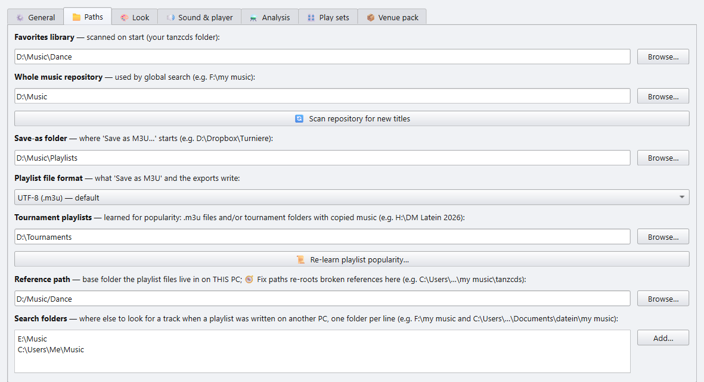

# 1 · Getting started

[Manual index](README.md)

The person running the music at a tournament does not plan anything. They
load a finished playlist and play it: timed, with the Paso Doble cut, the
spoken dance announcements, the presenter screen and the cartwall. The
**DanceSport Player** is the app for exactly that job.

You get it in two ways:

- the **player build**, `DanceSport-Player`, a program of its own for the
  venue PC;
- the full app set to the **app mode** *Player only*, under ⚙ Settings ▸
  ⚙ General ▸ **App mode**.

Both look and work the same. The window is titled **DanceSport Player** and
opens on the ▶ Playing side.

## The first start

On the first start the app opens on a layout for the venue:

- no playlist decks and no wishlists;
- an empty **Party** list, ready for an `.m3u` to be dropped on it;
- the 📚 library open;
- the 🎛 cartwall closed;
- the **🎉 Party set** on: full length, auto-advance, no pause, equalized
  volume. See [Play sets](04-playing.md#play-sets).

This happens only once. From the second start on, the app opens as you left
it.

## Point the app at your music

The first start asks for your music folder, with the one it found
preselected. Pick the folder that holds your dance music, not a whole drive:
every start reads the MP3 files below it, and the first start reads each one
once, which takes long on an external disk.

To change it later, open ⚙ **Settings**. The button is at the bottom of the
Playing panel. The first tab holds the folders:

| Field | What it is for |
|---|---|
| **Favorites library** | Your tournament music folder. It is scanned on every start and fills the 📚 library. |
| **Save-as folder** | Where **Save as M3U…** starts. |
| **Tournament playlists** | Your existing tournament `.m3u` files. The **Pop** column counts in how many of them a title appears. |
| **Reference path** | The folder the music lives in on *this* PC. A playlist written on another PC is moved onto it when you load it, see [chapter 3](03-playlists.md#playlists-from-another-pc). |
| **Search folders** | More places to look for a track when a playlist was written on another PC. One folder per line. |

The rest of this tab is covered in [Settings](06-settings.md).

## The first scan and the analysis

On start the app brings back your last session and opens, then scans the
Favorites library behind it. The status bar shows how far the scan is
(📚 Library: files done / all files). Your decks play right away; the
library browser and the 🏆 tournament list stay grey until the scan is done,
and the analyses say the library is still loading. ⏸ next to the bar pauses the scan and ▶ lets it go on; ⏹ stops it and
uses the titles read so far as the library, and the next start scans the
rest. Titles and tags are
cached, so only the first scan of a large library takes long.

Three features need a short analysis once per track:

- **🔊 Equalize volume** needs the loudness,
- the **🐂 Paso Doble stop** needs the highlights,
- skipping silence at the start and end needs the silences.

Start it with **🧱 Build ALL caches…** in ⚙ Settings ▸ ⚗ Analysis. The
analysis only *reads* your files and can be cancelled. Whatever is already
cached is reused.

Each run writes its progress to `session.log` in the app's data folder,
next to `audio_features.db`: how many files it starts with, a line every
5 % with the time left, and a summary with the errors at the end.

### Analyse at home, play at the venue

The analysis takes time you may not have on the day. Run it at home, then
copy `audio_features.db` next to `DanceSport-Player.exe` on the venue PC. The
player reads the stored values and needs no analysis at the venue.

## A tour of the main window

**Left: the side panel.** The player card on top, the Playing panel under it.
Both are described in [chapter 4](04-playing.md).

**Top: the toolbar.** On narrow screens the buttons shrink to their icons.
Hover over one for its full name.

| Button | Does |
|---|---|
| ⊟ Collapse all | Collapses every round and dance header. Click again to open them. |
| ▴ Fold decks | Folds every deck and wishlist to a header tab. |
| 💾 Save all | Writes every non-empty deck to its own `.m3u`. |
| 📌 Save state | Saves the whole session now. This also happens by itself on every edit and on close. |
| 🧹 Clear all | Empties every deck. Wishlists are kept. |
| 🚦 Check ▾ | **🚦 Ready?**, the check before the evening, see [chapter 4](04-playing.md#-ready-before-the-evening). The full app adds 🔁 Check duplicates, 🎵 Check music and 🧭 Fix paths to this menu. |
| ⧉ *n* playlists | Cycles through the number of decks on screen. A right click goes backwards. |
| 🗜 Compact | Cycles the header view: full → compact → no groups → numbered. |
| ⭐ *n* wishlists | Cycles the wishlist area: off → 1 → 2 → 3 → 4 → 2×2. |
| 🤸 Party ▾ | Shows or hides the Party panel. |
| 📚 Library | Shows or hides the library and tournaments pane. |
| 🎛 Cartwall | Shows or hides the sample-pad wall. |
| ❔ | A menu: ⌨ Keyboard shortcuts (**F1**), 📖 Manual, 📜 Played titles…, ⚙ Settings… (**F12**), ℹ About… and ⛶ Fullscreen (**F11**). |

**Middle: the decks.** Each deck is one playlist, see
[chapter 3](03-playlists.md).

**Below the decks: the Party panel and the wishlists**, and under them the
**📚 Library / 🏆 Tournaments** pane, see
[chapter 2](02-library-and-tournaments.md).

**Bottom:**

- the undo and redo buttons, with the number of steps they can go back;
- the title that is cued on the player;
- the status bar. While the 📱 phone remote runs, a green **📱 Remote** badge
  sits at its right end; a click on it opens the remote's window, see
  [chapter 4](04-playing.md#-the-phone-remote).

Everything you see is saved as you work: decks, wishlists, the window layout
and the fold state. The next start brings it back exactly as it was.

### ⛶ Fullscreen

**F11**, or ❔ ▸ **⛶ Fullscreen**, lets the window fill the screen. **F11**
again, or ❔ ▸ **⛶ Exit Fullscreen**, brings it back. In fullscreen the
status bar shows a clock at its right end, with the date and the seconds:
*Sat, 10.10.2026 20:45:12*. To see the time alone, tick **⛶ Fullscreen clock:
only the time** in ⚙ Settings ▸ 🎨 Look.

### Closing the app

Closing the window while music plays would stop it on the floor, so the app
asks first: *Music is playing. Quit anyway and stop it?* **No** is the
default and keeps everything running. Paused or stopped, the app closes at
once.

## The player build

The player build is about 220 MB. It is built with `build_player.bat`; see
`BUILD.md` in the project. It keeps everything a tournament runs on:
playback and the ±16 % tempo fader, equalized volume, the Paso Doble
highlight detection, the silence detection, the cartwall, the library and
the announcements.

Run from the full app in player mode, the app also offers **🖨 Print**, a PDF
of the running order, and up to eight decks.

Next: [Library and Tournaments](02-library-and-tournaments.md)
