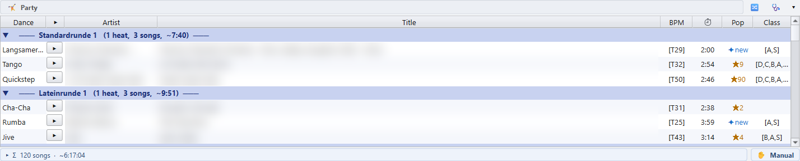

# 3 · Playlists

[Manual index](README.md) · previous: [Library and Tournaments](02-library-and-tournaments.md)

The player holds its music in three kinds of lists:

- the **decks**, one per competition or per part of the evening;
- the **Party panel**, for a long social evening;
- the **wishlists**, for titles you want to keep at hand.

## The decks

**⧉ *n* playlists** in the toolbar sets how many decks are on screen. Each
deck is a **running order**: the titles play from top to bottom.

- A competition playlist is still shown in its rounds and dances. Click a
  round or dance header to collapse it.
- Any row can be dragged anywhere, also into another deck.
- A title dropped onto a deck, from the library, a wishlist or Explorer, is
  **added** where it was dropped. It never replaces the title that was there.
- **Del** takes the selected titles out of the running order, after asking.
  In a party list the question is **Remove with slot**, **Keep slot** or
  **Cancel**; decks ask yes or no. Afterwards the selection sits on the row
  that moved up into the spot (the new last row when the last title went).
- **⬇ Move to the end of the list** in the right-click menu of a party list,
  a free order or a wishlist sends the title last. A selection goes together.
- **Ctrl + Z / Ctrl + Y** undo and redo every change. The ↶ / ↷ buttons at the
  bottom show how many steps are available.
- Double-click the deck title to rename it. **▾** in the header folds the
  deck to a tab.

The columns:

- **Dance / Heat**: which dance and heat the row is.
- **▶**: plays or stops exactly this title.
- **Title**: the MP3's title tag. A file without one shows its cleaned-up
  file name.
- **BPM**: the tempo in bars per minute. It is read from the file name
  (`[T51]`) first, then from the MP3's BPM tag, then from a tempo written in
  the title tag. A BPM tag counts beats, so it is turned into bars per
  minute, and it is only used when it lands near the TSO range of the dance.
  The cell's tooltip says where the tempo came from. `[?BPM]` means the file
  carries no tempo.
- **⏱**: the length. It is **orange** when the title is shorter than the play
  length, or when 5 s or more of silence at an edge will be skipped.
- **Pop**: `★58` means the title is in 58 of your tournament playlists.
  **✦ new** means it is in none.
- **Class**: the class tags from the MP3 comment, for example `[B,A,S]`.

Five more columns are hidden at first. Right-click the column header to
show them: **★** rates a title with a click, **Custom** holds a free text per
title, **Filename** shows the cleaned-up file name, with the full path
in its tooltip, **Album** shows the album tag of the MP3, and **Comment**
its comment as written (e.g. "vocal AS"). ★ and Custom are described in [chapter 5](05-tags.md).

**Plays** (hidden at first too) counts how often a title has played in the
last 24 hours, from any list: "2" in every list that holds it, wherever it
ran. A play counts once the title has been heard for 10 seconds in playing
mode, the same rule as the 📜 play log. **Reset the play counters** in the
column header's right-click menu sets every count back to zero; the play log
itself keeps every title. The library and the 🏆 track list have the same
column.

**Reset the played titles (grey)**, in the same menu, takes the grey off
every list without a restart. The counters and the play log stay as they
are, and a title on air that has already counted stays played.

Drag a column header sideways to move the column. The new order holds
for every list of that kind (all decks, all wishlists or all party lists)
and is kept for the next start. **Dance** stays first and **↺** last. A
shown **Album** starts right after **Title**.

Row colours:

- an **orange** row is marked, for example as a title to swap later
  (**Ctrl + M**);
- a **light red** row with ❗ on its ▶ points at a file that is gone. Once
  the file is back and the title plays, the mark goes away. A title that
  would not play turns red the same way, with the reason in its tooltip,
  see [chapter 4](04-playing.md#a-title-that-wont-play);
- a **lilac** row with **📌** in front of its title is pinned.

**📌 Pinning a title.** Right-click a title of a round ▸ **📌 Pin — keep this
title when the round is re-rolled**. When the round or its dance is generated
again on the planning side, a pinned title keeps its slot; re-rolling its own
row says it is pinned instead of replacing it. **📌 Unpin** takes the pin off.
Pins are saved with the deck and go when the deck is cleared.

The bar under the deck shows the **Σ** song count and total time. Click ▸ for
the count per dance. The **✋ Manual / ⏭ Auto** switch sets whether the deck
plays on by itself, see [chapter 4](04-playing.md#starting-a-title).

Right-click a title for **🏷 Re-read MP3 tags**, **🏷 Edit tags…** (see
[chapter 5](05-tags.md)), **📋 Copy file path**, **📂 Show in Explorer**,
**↩ Reset time marker** (only on a title that has one) and the save and
import entries below.

## 🤸 The Party panel

The Party panel holds one long list for a social evening. It sits between the
decks and the wishlists. **🤸 Party ▾** in the toolbar shows or hides it, and
**▾** in its header folds it.

A list you open here comes up at full size: the playlists are switched off and
one wishlist stays. The playlist button in the toolbar brings them back.

- Drop an `.m3u` onto the panel to load it. The panel is named after the
  file. A competition running order dropped here is split into the rounds it
  is played in, such as *Vorrunde* and *Finale*.
- A list built in rounds is grouped by them, for example *Standardrunde*,
  *Lateinrunde* and *Socialrunde*.
- **⇅ Swap these two titles** (right-click, or **Alt + S**) swaps two selected
  titles of the same dance, so every round keeps its dances.
- **🗑 Remove this title (keep slot)** (right-click) leaves an empty row.
  **🗑 Remove this title and its slot** takes the row out as well. Decks offer
  it too, where the title is the only one of its dance in the round: the dance
  then leaves that round.

Playing from the panel switches to the **🎉 Party set** by itself: full length,
auto-advance, no pause, see [chapter 4](04-playing.md#play-sets).

### A title the list already holds

A list holds a title only once. Drop one title on a deck or the Party panel
that already holds it, and the list asks what to do:

- **Replace** moves the title here from its old place. Dropped on another
  title (a slot of a deck, or **Shift** in the Party panel), that title leaves
  the list.
- **Swap** exchanges the two titles.
- **Cancel** leaves the list as it was.

An empty slot offers **Replace** (the title moves here) instead of the first
two. Several titles dropped at once skip the ones the list already holds.

The question does not block the app: the player stays usable while it is up,
and the longer hints are tooltips on the buttons. **Replace** and **Swap** flash
the rows they changed in blue for about a second (Replace shows the old place
and the row where the title landed). If the list changed while the question
was open, nothing is done and a message says so.

In playing mode a drop into a party list also offers **Add**: the title plays
here and stays at its old place as well. Once it has played, both rows turn
grey, and a grey row still plays when its turn comes. In planning mode a list
never gets a second copy.

## ⭐ Wishlists

A wishlist is a flat list of titles you want to keep at hand: requests from
the floor, a new album you want to try.

- Drag titles in from a deck, the library or Explorer. Drag them out onto a
  deck.
- **⭐ n wishlists** in the toolbar shows up to four wishlists, or a 2×2 grid.
- Double-click the title to rename it. Drag one wishlist header onto another
  to swap them.
- Right-click a wishlist or its header ▸ **↔ Expand this wishlist**, or press
  **Ctrl + Shift + E**: it gets the whole area and the others fold to tabs.
  The same entry and key open them all again.
- The bar underneath counts the titles and how many are new (never played).

Wishlists are kept by **🧹 Clear all**.

## Loading and saving

| To | Do |
|---|---|
| Load an `.m3u` into a deck or wishlist | Right-click ▸ **📂 Import M3U…**, or drop the `.m3u` onto it. Several `.m3u` dropped at once go into the free decks, one each. |
| Load a [venue pack](06-settings.md#venue-pack) from another PC | Drop the `.dpvenue` file onto the program window, or right-click ▸ **📥 Import venue pack…**. It is the same as in ⚙ Settings. |
| Load a playlist from your tournament archive | Drag its slot from 🏆 Tournaments onto a deck, see [chapter 2](02-library-and-tournaments.md#-tournaments). |
| Save the focused deck or wishlist | **Ctrl + S**, or right-click a title or the header ▸ **💾 Save as M3U…** |
| Save it and file it in the Tournaments tree | Right-click ▸ **🏆 Save and add to Tournaments…** |
| Save every deck at once | **💾 Save all** in the toolbar. Each file is named after its deck title. |

On import, a deck recognises rounds, dances and heats by itself, including a
final with extra backup titles. A wishlist appends the tracks as a flat list.

### The playlist file format

Every playlist the app writes is UTF-8, so umlauts and accents survive. The
**Playlist file format** in ⚙ Settings ▸ 📁 Paths picks one of three:

- **UTF-8 (.m3u)**: the default, read by current players.
- **UTF-8 with BOM (.m3u)**: for an older Windows tool that shows `ü`
  instead of `ü`.
- **UTF-8 (.m3u8)**: the same UTF-8, under the extension some players
  expect.

Save as M3U, 💾 Save all and the exports all follow it. The app reads all
three back, and `.m3u8` files count for the **Pop** column too.

## Playlists from another PC

A playlist file stores the full path of every track. When it was written on
another PC, or the music moved to another drive, those paths are wrong. The
player repairs them as it loads the playlist, with two settings in
[⚙ Settings ▸ 📁 Paths](01-getting-started.md#point-the-app-at-your-music):

- **Reference path**: the folder the music lives in on *this* PC;
- **Search folders**: more places to look, one per line.

The app tries the Reference path first, then the search folders in order. It cuts
the old path from the front until the rest points at a real file under one of
them. For example, `D:\Musik\tanzcds\lateincd\Samba.mp3` becomes
`F:\my music\tanzcds\lateincd\Samba.mp3`. A path is only ever changed to a file
that really exists.

When a path had to change, a window says how many tracks were re-rooted and
how many could not be found; **Show Details** lists every old and new path. A
title that could not be found shows in red with ❗. Add the folder it is in
under Search folders, then import the playlist again.

Before the evening, **🚦 Check ▸ 🚦 Ready?** counts the titles that are
missing or not on the Reference path. Its **🧭 Fix paths** button, on the
📁 Music files line, moves the decks onto the copies there, see
[chapter 4](04-playing.md#-ready-before-the-evening).

Next: [Playing the evening](04-playing.md)
