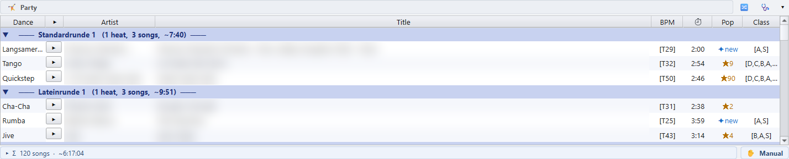

# 3 · Playlists

[Manual index](README.md) · previous: [Library and Tournaments](02-library-and-tournaments.md)

The player holds its music in three kinds of lists:

- the **decks**, one per competition or per part of the evening;
- the **Party panel**, for a long social evening;
- the **wishlists**, for titles you want to keep at hand.

## The decks

**⧉ *n* playlists** in the toolbar sets how many decks are on screen. Each
deck is a **running order**: the titles play from top to bottom.

- A competition playlist is still shown in its rounds and dances. Click a
  round or dance header to collapse it.
- Any row can be dragged anywhere, also into another deck.
- A title dropped onto a deck, from the library, a wishlist or Explorer, is
  **added** where it was dropped. It never replaces the title that was there.
- **Del** takes the selected titles out of the running order, after asking.
- **Ctrl + Z / Ctrl + Y** undo and redo every change. The ↶ / ↷ buttons at the
  bottom show how many steps are available.
- Double-click the deck title to rename it. **▾** in the header folds the
  deck to a tab.

The columns:

- **Dance / Heat**: which dance and heat the row is.
- **▶**: plays or stops exactly this title.
- **Title**: the MP3's title tag. A file without one shows its cleaned-up
  file name.
- **BPM**: the tempo in bars per minute. It is read from the file name
  (`[T51]`) first, then from the MP3's BPM tag, then from a tempo written in
  the title tag. A BPM tag counts beats, so it is turned into bars per
  minute, and it is only used when it lands near the TSO range of the dance.
  The cell's tooltip says where the tempo came from. `[?BPM]` means the file
  carries no tempo.
- **⏱**: the length. It is **orange** when the title is shorter than the play
  length, or when 5 s or more of silence at an edge will be skipped.
- **Pop**: `★58` means the title is in 58 of your tournament playlists.
  **✦ new** means it is in none.
- **Class**: the class tags from the MP3 comment, for example `[B,A,S]`.

Three more columns are hidden at first. Right-click the column header to
show them: **★** rates a title with a click, **Custom** holds a free text per
title, and **File name** shows the cleaned-up file name, with the full path
in its tooltip. ★ and Custom are described in [chapter 5](05-tags.md).

Row colours:

- an **orange** row is marked, for example as a title to swap later
  (**Ctrl + M**);
- a **light red** row with ❗ on its ▶ points at a file that is gone. Once
  the file is back and the title plays, the mark goes away. A title that
  would not play turns red the same way, with the reason in its tooltip,
  see [chapter 4](04-playing.md#a-title-that-wont-play);
- a **lilac** row with **📌** in front of its title is pinned.

**📌 Pinning a title.** Right-click a title of a round ▸ **📌 Pin — keep this
title when the round is re-rolled**. When the round or its dance is generated
again on the planning side, a pinned title keeps its slot; re-rolling its own
row says it is pinned instead of replacing it. **📌 Unpin** takes the pin off.
Pins are saved with the deck and go when the deck is cleared.

The bar under the deck shows the **Σ** song count and total time. Click ▸ for
the count per dance. The **✋ Manual / ⏭ Auto** switch sets whether the deck
plays on by itself, see [chapter 4](04-playing.md#starting-a-title).

Right-click a title for **🏷 Re-read MP3 tags**, **🏷 Edit tags…** (see
[chapter 5](05-tags.md)), **📋 Copy file path**, **📂 Show in Explorer** and
the save and import entries below.

## 🤸 The Party panel

The Party panel holds one long list for a social evening. It sits between the
decks and the wishlists. **🤸 Party ▾** in the toolbar shows or hides it, and
**▾** in its header folds it.

- Drop an `.m3u` onto the panel to load it. The panel is named after the
  file. A competition running order dropped here is split into the rounds it
  is played in, such as *Vorrunde* and *Finale*.
- A list built in rounds is grouped by them, for example *Standardrunde*,
  *Lateinrunde* and *Socialrunde*.
- **⇅ Swap these two titles** (right-click, or **Alt + S**) swaps two selected
  titles of the same dance, so every round keeps its dances.

Playing from the panel switches to the **🎉 Party set** by itself: full length,
auto-advance, no pause, see [chapter 4](04-playing.md#play-sets).

## ⭐ Wishlists

A wishlist is a flat list of titles you want to keep at hand: requests from
the floor, a new album you want to try.

- Drag titles in from a deck, the library or Explorer. Drag them out onto a
  deck.
- **⭐ n wishlists** in the toolbar shows up to four wishlists, or a 2×2 grid.
- Double-click the title to rename it. Drag one wishlist header onto another
  to swap them.
- The bar underneath counts the titles and how many are new (never played).

Wishlists are kept by **🧹 Clear all**.

## Loading and saving

| To | Do |
|---|---|
| Load an `.m3u` into a deck or wishlist | Right-click ▸ **📂 Import M3U…**, or drop the `.m3u` onto it. Several `.m3u` dropped at once go into the free decks, one each. |
| Load a playlist from your tournament archive | Drag its slot from 🏆 Tournaments onto a deck, see [chapter 2](02-library-and-tournaments.md#-tournaments). |
| Save the focused deck or wishlist | **Ctrl + S**, or right-click a title or the header ▸ **💾 Save as M3U…** |
| Save it and file it in the Tournaments tree | Right-click ▸ **🏆 Save and add to Tournaments…** |
| Save every deck at once | **💾 Save all** in the toolbar. Each file is named after its deck title. |

On import, a deck recognises rounds, dances and heats by itself, including a
final with extra backup titles. A wishlist appends the tracks as a flat list.

### The playlist file format

Every playlist the app writes is UTF-8, so umlauts and accents survive. The
**Playlist file format** in ⚙ Settings ▸ 📁 Paths picks one of three:

- **UTF-8 (.m3u)**: the default, read by current players.
- **UTF-8 with BOM (.m3u)**: for an older Windows tool that shows `ü`
  instead of `ü`.
- **UTF-8 (.m3u8)**: the same UTF-8, under the extension some players
  expect.

Save as M3U, 💾 Save all and the exports all follow it. The app reads all
three back, and `.m3u8` files count for the **Pop** column too.

## Playlists from another PC

A playlist file stores the full path of every track. When it was written on
another PC, or the music moved to another drive, those paths are wrong. The
player repairs them as it loads the playlist, with two settings in
[⚙ Settings ▸ 📁 Paths](01-getting-started.md#point-the-app-at-your-music):

- **Reference path**: the folder the music lives in on *this* PC;
- **Search folders**: more places to look, one per line.

The app tries the Reference path first, then the search folders in order. It cuts
the old path from the front until the rest points at a real file under one of
them. For example, `D:\Musik\tanzcds\lateincd\Samba.mp3` becomes
`F:\my music\tanzcds\lateincd\Samba.mp3`. A path is only ever changed to a file
that really exists.

When a path had to change, a window says how many tracks were re-rooted and
how many could not be found; **Show Details** lists every old and new path. A
title that could not be found shows in red with ❗. Add the folder it is in
under Search folders, then import the playlist again.

Before the evening, **🚦 Check ▸ 🚦 Ready?** counts the titles that are
missing or not on the Reference path. Its **🧭 Fix paths** button, on the
📁 Music files line, moves the decks onto the copies there, see
[chapter 4](04-playing.md#-ready-before-the-evening).

Next: [Playing the evening](04-playing.md)
