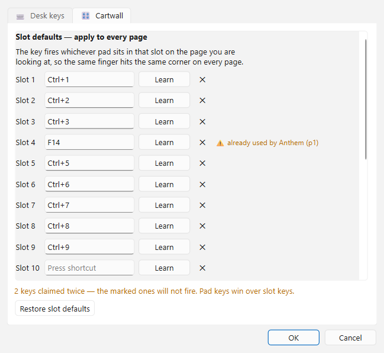
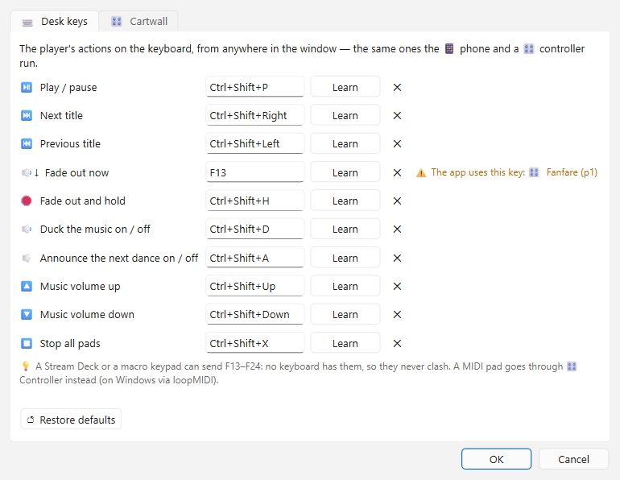

# 4 · Playing the evening

[Manual index](README.md) · previous: [Playlists](03-playlists.md)

The side panel holds the player card and, under it, the Playing panel. You
play straight from the decks, the Party panel and the wishlists.

## 🚦 Ready? before the evening

**🚦 Check ▸ 🚦 Ready?** in the toolbar checks every deck that holds titles,
and the Party list, in one go. It shows one traffic light per check and an
overall verdict: 🟢 *Ready*, 🟡 *Playable, with loose ends* or 🔴 *Not
ready*: some titles will not play, or a sound output is not connected.

| Line | Checks |
|---|---|
| 📁 Music files | Every file is there. A drive that is not plugged in is named as such. Titles that are not on the Reference path turn the line yellow. |
| 📊 Loudness | Every title is measured, so 🔊 Equalize volume can stay on. |
| 🔇 Silence probe | Every title is probed, so its silent edges are skipped. |
| 🐂 Paso Doble highlights | Every Paso Doble knows its highlights. |
| 🔁 Duplicates | No title is in two lists. |
| 🎶 Playlists | There is something to play at all. |
| 🔈 Sound outputs | Every output chosen in ⚙ Settings → 🔊 Sound & player is plugged in. A missing card for the music, the filler, the cartwall or the announcements is red: that source plays on the system default instead. A missing 🎧 Pre-listen card is yellow, and so is a pre-listen that would land on the music's own output, because every preview would be refused. Pre-listen left on *Same as the music* is yellow too, because the hall hears every preview. With one output only there is no other to choose, so nothing is flagged. |
| 🎛 Controller | The chosen hardware controller is connected. Not every evening needs one, so this line is yellow at worst, and it is left out while no controller is set up. |
| ☀ Screen and sleep | ☀ Keep the screen awake is on, so the screen, the beamer and the computer stay awake while music plays or the presenter screen is up. |

A line that is not green has a button that fixes it: **📊 Measure
loudness…**, **🐂 Find highlights…**, **🔁 Resolve duplicates…**,
**⚙ Choose outputs…**, **🎛 Open the controller…** or **☀ Keep it awake**.
**🧭 Fix paths…** stands on the 📁 Music files line every time, green or
not. The window stays open while a fix runs; **↻ Check again** grades anew.
The full app adds a 🎵 Music check line for tempo, length and round
structure.

## Starting a title

- **▶** in a row plays exactly that title. **■** stops it.
- **Space** pauses and resumes the player, wherever the focus is, except in a
  text field, and in another list with a title selected, where it starts
  that title.
- **Enter** starts the title selected in the list in focus, also in the
  list that is playing.
- **Double-click** a row either starts it at once, or only *cues* it: it is
  loaded and shown, silent, and ⏯ starts it. The switch for this is
  **▶️ Double-click starts the title** in the Playing panel, see below.
  While a title is playing, the double-click asks first (**Stop the playing
  title?**), and **No** keeps the music on. Whether it asks is set per play
  set, with **❓ Ask before a double-click stops the title** in
  [⚙ Settings ▸ 🎛 Play sets](06-settings.md#play-sets); on in both.
- **Ctrl + Shift + ← / →** jumps to the previous or next title, and
  **Ctrl + ← / →** seeks 30 s.

Every deck has its own **✋ Manual / ⏭ Auto** switch in its bottom bar:

- **⏭ Auto**: a finished title is followed by the next row, so a whole round
  runs hands-free.
- **✋ Manual**: you start every title yourself. The spoken announcement is off
  as well. When a title ends, by a fade-out, the play length or its natural
  end, the next row is put on the player card at 0:00, silent, with its row
  marked. **⏯** starts it, and **⏭** walks on from there.

Each list remembers its own answer. The party list can run by itself while the
competition deck next to it is started by hand.

### A title that won't play

When a file is damaged or gone, the player does not leave the floor in
silence: it names the title in a short message, turns its row red with the
reason in the tooltip, and starts the next title of the same round. At the
end of a round it stops, as it would after any last title. The mark goes as
soon as the file plays again.

## The player card

The card at the top of the side panel shows the running title, its dance and
the time left.

| Control | Does |
|---|---|
| **\|◀** | Jumps back to 0:00 of this title. |
| **⏮ / ⏭** | Previous / next title. |
| **◀◀ / ▶▶** | Back / forward 10 s. |
| **⏯** | Pause / resume. |
| **🔁** | Repeats *this* title endlessly, for when the floor is still full or a speech runs long. It works with ⏭ Auto off, too. |
| fade button (muted speaker) | Fades the title out now, over the fade time, then ends it. |
| **☕** | Ends the title and goes straight to the pause music. Only there while **Pause between songs** is on. |
| extend button | Adds another pause length when the heat change takes longer. |
| **⊗** | Panic: fades the music out and *holds* it. Nothing ends and nothing advances. **⏯** resumes at exactly that spot. |
| **🔊** | Ducks to 20 % and back to full. The pause music comes down too. The level is set under ⚙ Settings ▸ 🔊 Sound & player ▸ **🔉 Duck to**. |
| volume slider | Master volume. |

### 〰 The waveform

Below the time sits the running title's **waveform**: the quiet passages,
the silence that is skipped, the Paso Doble highlights and where the
fade-out of a timed cut begins. In the last seconds it turns red.

- **Click** it to jump to that spot. **Drag** along it to scrub: the playhead
  and the times follow the mouse, and the music jumps when you let go. A drag
  off the left edge goes to 0:00.
- The waveform replaces the seek bar, which covers the same stretch: you
  see one or the other, never both. To get the seek bar back, switch
  **〰 Show waveform** off in
  [⚙ Settings ▸ 🔊 Sound & player](06-settings.md#sound-and-player).

The tempo row under it:

- **Tempo fader**: −16 % to +16 % without changing the pitch (time stretch),
  for example to pull a title onto the tempo the tournament needs. **− / +**
  step it, hold them to glide. **0** or a double-click on the fader resets it.
  [Desk keys](#-desk-keys) and a knob on a
  [hardware controller](#-a-hardware-controller) move it too.
- **CR**: while on, every title is pitched to the average tempo of its dance
  in this round, kept inside the tempo range of the WDSF Competition Rules. A
  Rumba at 23 becomes T24, a Paso Doble at 57 becomes T58. With the German
  dance and round names kept (⚙ Settings → Language) the button reads
  **TSO**, after the German rule book.
- **📌**: pins the tempo, so the fader stays where you left it when the next
  title starts.
- **♪**: tap along to the beat to measure the live tempo by hand. This is for
  display only and changes nothing.

## The Playing panel

### Play length and fade

- The big number is the **play length**: every title stops after this time.
  **− / +** change it in steps. Past the last step the title plays to its end
  (**full**). Double-click the number to type an exact length, for example
  `1:37`.
- **Fade-out**: the volume ramps to 0 over the last seconds.
- **within the length**: ticked, the fade-out ends at the play length, so a
  1:45 title with a 3 s fade starts fading at 1:42. Unticked, the title plays
  its full 1:45 and then fades, so it ends at 1:48.

Once the analysis has measured it, silence at the start and end of a title
is skipped.

### 🐂 Paso Doble

**🐂 Stop Paso Doble after highlight**: a Paso Doble is not faded out. It stops
at a highlight, the musical break the couples dance to.

- **Stop after highlight** picks which one, usually the 2nd.
- The highlights are detected by the analysis. When one is missing or wrong,
  click **🎯 Mark highlight now** exactly on the highlight while the title
  plays. **✖** forgets the learned marks of this title.
- **✏️ Edit highlights** pauses the music and suspends the stop, so you can
  scrub through the whole title and set its marks.
- **Start after** holds a Paso Doble back before the music starts, so the
  couples can take their position. A Paso Doble picked up again at its
  ↩ mark starts at once: the couples are still on the floor.

With the switch off, a Paso Doble is an ordinary title.

### Advance and pause

- **⏭ Auto-advance to next song**: the same switch as ⏭ Auto on the deck you
  last clicked.
- **🔁 Start again at the end**: after the last title, the list starts over.
  Needs auto-advance.
- **Pause between songs**: time for the couples to change or catch their
  breath. Off, the next title follows at once.
- **Pause music**: 📂 picks one or more titles, or an `.m3u`, that play during
  the pause. ✕ removes it. **Pause music volume** sets how loud it plays.
- **🔀 Crossfade**: the last seconds of a title and the first of the next
  play together. The old one fades out while the new one fades in, so the
  floor never hears a gap. The caption is a switch: off, one title ends and
  the next starts. The seconds beside it (0.5 to 10, in half-second steps)
  stay set while it is off, so switching it on comes back on them; the
  first time that is 4 s. The small picture shows the fade the way a DJ mixer
  does: red is the title going out, green the one coming in, and the steeper
  the cross, the shorter the fade. *off* is a hard cut.

  The button left of the picture picks the fade's shape, and the picture
  follows it:
  - **equal power** (the default): the two titles add up to one steady level
    all the way across, right for two unrelated songs.
  - **linear**: two straight lines, the way a plain mixer fader does it,
    a little quieter in the middle.
  - **S-curve**: steady like equal power, but slow off both ends: the new
    title is barely there at first, the old one lingers.

  A fade that is already running keeps the shape it started with. Around
  it, a yellow line walks across the picture, with a dot on each curve
  where the two titles stand. It comes in at the left edge a few seconds
  before the fade, reaches the ramp the moment the next title starts, and
  goes out at the right edge after it, so you can see a crossfade coming.

  It only happens where the list walks on by itself with no pause. A pause,
  ⏭ auto-advance off, the 🏁 end of a round, a 🔁 title, a 🐂 Paso Doble run
  to its highlight and a 🔉↓ fade by hand all keep the ordinary ending. While
  a pause is on, the row is gone: a pause needs no crossfade, and what the
  pause switch shows sits right under it. ⏭ fades into the
  next title the same way, even into the next round. ⏹, ⏭ or a click on
  another title during the fade cuts the old title off at once. Every playlist keeps its own
  value.

### 🔈 Announce next dance

The app says the next dance out loud: "Nächster Tanz: Langsamer Walzer".

- With a pause, the call comes shortly before the pause ends.
- Without a pause, the dance is named as the title starts: **over the first
  bars** (the music is ducked under the voice) or **before the music starts**
  (the music follows the call), as ⚙ Settings ▸ 🔊 Sound & player has it.
- With 🔀 Crossfade, the dance is named once the crossover is through, over
  the music, whatever the setting says. A 🐂 Paso Doble with a start
  wait is named once, at the head of its wait.
- The voice, the heat number and the over/before choice are set in
  ⚙ Settings ▸ 🔊 Sound & player (see [Settings](06-settings.md)). While the
  switch is on, a line under it names the choice in short, such as *Mixed
  voices · with heat · over the music*. Under a crossfade the last part is
  left out. A dance that was never recorded is not announced.
- The call is in German on a German screen, and on an English one with
  **Keep the German dance and round names** ticked. Otherwise it is English
  ("Next dance: Slow Waltz"); a clip missing from the English recordings is
  played from the German ones.

### Sound and display

- **🔊 Equalize volume (R128)**: levels the loudness between titles. It needs
  the loudness analysis.
- **▶️ Double-click starts the title**: on, a double-click plays at once. Off,
  it only cues the title and ⏯ starts it. That is what a heat wants.
- **↩ Remember where a title stopped**: a title you left starts again at that
  spot. The row shows **↩ mm:ss**. The marks are forgotten when the app
  closes.

### Play sets

Two buttons switch the whole panel over in one go:

- **🏆 Tournament set**: 1:45 play length, then a 2.5 s fade-out after it, no
  pause, no crossfade, no auto-advance, no announcement, equalized volume.
  It also puts the 🐂 Paso Doble on the set's values: out of the box the
  stop off and Start after 0 s. It is lit gold while the panel is on those
  values.
- **🎉 Party set**: every title at full length with a 3 s fade-out within it,
  no 🔀 crossfade, auto-advance, no pause, no announcement and equalized
  volume. The 🐂 Paso Doble stops after its 2nd highlight and starts
  after 3 s. It is applied by itself when you play
  from the 🤸 Party panel, and switched back when a tournament deck takes
  over.

Click a lit set again to switch it off: the list goes back to the values it
stood on before you pressed it. With nothing to go back to, for example after
the app was restarted, the set stays on and a note says so.

What each set contains is yours to change, in
[⚙ Settings ▸ 🎛 Play sets](06-settings.md#play-sets).

The tournament set can also give a dance **its own play length**, for
example 1:30 for the Viennese Waltz and 1:37 for the Tango. While a list is on
the 🏆 set, the big number shows that dance's length, and the dance is named in
gold underneath. This is the dance that is playing, or else the row you
picked. **− / +** and typing then change that dance's length, not the list's.
Change the list's length by hand and the list leaves the set: from then on its
one length applies to every dance. Out of the box the 🏆 set plays 1:30 for
the Waltz, Viennese Waltz, Quickstep and Jive, and 1:37 for the Tango,
Slow Foxtrot, Samba, Cha-Cha-Cha and Rumba; the Paso Doble has no length of its own.

### 🖥 Presenter

**🖥 Presenter** opens a second, full-screen window for a beamer or a monitor
turned towards the floor. It shows the running title with its dance and the
next three titles.

- The box next to it picks the screen.
- **🕒**, at the end of the same row, holds a running order for the evening, such as dinner or the opening
  dance. It is a second page on the presenter. **T** there switches pages.
- **Esc** closes the presenter. A double-click on it leaves full screen.

Its colours are set in
[⚙ Settings ▸ 🎨 Look](06-settings.md#look).

**☀ Keep the screen awake** stops the screensaver and the display timeout
while music plays or the presenter is open.

## 🎧 Pre-listening on headphones

With a second output, for example headphones on the desk, you can listen to
a title while the hall hears the music. Pick that output in
[⚙ Settings ▸ 🔊 Sound & player ▸ 🔈 Outputs ▸ 🎧 Pre-listen](06-settings.md#-outputs).

- **▶** in the 📚 Library and in the 🏆 Tournaments pane then plays on the
  pre-listen output. The music keeps running.
- The pre-listen has a mini player of its own, with a seek bar, ⏮ / ⏭ and
  its volume. **✕** on it stops only the pre-listen.
- **Ctrl+←/→** seeks the pre-listen by 30 s while it plays, from the panes
  and windows that pre-listen. On a deck row they still seek the music.
- **▶** on a deck row still starts the music for the hall.
- A pre-listen output that is not plugged in plays on the system default
  instead. When that default is the music's own output, the pre-listen is
  refused, with a message: a preview on the PA is worse than none. A
  computer with one output only has no other to choose, so there the
  pre-listen plays on it.
- Left on **Same as the music**, ▶ in the 📚 Library and the 🏆 Tournaments
  pane still plays in that mini player, on the music's own output and
  alongside the music. The main player and its card are left alone. A deck's
  ▶ stops it.

## 🎛 The cartwall

**🎛 Cartwall** in the toolbar shows a wall of sample pads: fanfares, a
drum roll, the national anthem, a jingle for the award ceremony.

- **Click a pad** to fire it over the running music. Click it again to fade
  it out, over 1 s. Right-click a pad ▸ **⏱ Wall fade-out…** sets that time
  for the whole wall; **Own fade-out** in a pad's **Settings…** gives one
  pad its own.
- **Ctrl + 1 … 9** fire the first nine pads of the page on screen.
- **⏹ Stop all** or **Esc** fades every pad out.
- **🔊** beside it is the cartwall's own volume, for every pad. It is apart
  from the music volume: pulling the music down leaves the pads where they
  are. A pad's own volume (its **Settings…**) is set relative to it. The
  **Ctrl + Alt + ↑ / ↓** keys and a controller fader move it too.
- **✏** unlocks the wall for building. Drop audio files on a pad to fill it.
  A multi-select fills the free pads after it. Drag one pad onto another to
  swap them. Lock the wall again before the tournament, so nothing moves by
  accident.
- **Right-click a pad** for its 🎨 colour, or **Settings…** for its label,
  volume, own shortcut key, 🔁 endless repeat, and whether it ducks the music.
- **🎶 Background** turns that round: the pad itself goes silent while a
  title plays and fades back in once the title has ended. Use it for a bed that runs
  through the evening. A background pad never ducks the music.
- **S Stop the other pads** in a pad's **Settings…** fades every other
  running pad out as this one starts, for an anthem or a winners' fanfare
  that needs the room.
- A pad's face shows how it behaves: 🔁 endless repeat, ↓ ducks the music,
  ♫ background, 🅂 stops the other pads, and its volume when it is below 100 %.
- With **✏** on, a click selects a pad instead of firing it, and **Ctrl+click**
  or **Shift+click** adds more. A right-click on a selected pad then works on
  all of them: 🎨 colour, 🗑 clear, or **Settings…**, where only what you
  change reaches the other pads, for example 🔈 ducking or 🅂 for six pads at
  once. Label and shortcut key stay with each pad.
- The page arrows, shown once there is a second page, switch pages, and so do **Ctrl + Alt + ← / →**. Double-click the page name to rename it. The
  size box sets the grid, for example 2 × 7. A smaller grid never loses a pad.
- **🗂** exports or imports the wall, or packs all pads onto one page.
- Drag the wall to the left or right of the window, below the decks, or out
  as its own window. **📌** snaps a floating wall back.

### ⌨ The cartwall's keys

**Right-click a pad ▸ ⌨ Shortcuts…** opens the **⌨ Keys** window on its
**🎛 Cartwall** tab. While the wall is unlocked with ✏, the **⌨** button
beside ✏ opens it too. The tab lists every key the wall answers to:

- **Slot defaults** fire whichever pad sits in that slot on the page on
  screen, so the same finger hits the same corner on every page. Slots 1 to
  9 start on **Ctrl + 1 … 9**.
- **Pad keys** travel with their pad, wherever it is moved, and work from any
  page. A pad without one answers to its slot's key.

To give a key, click **Learn** and press it. Any key works, F13 to F24 from
a Stream Deck or a macro keypad too. While it waits, **Learn** reads
**Cancel**: a second click keeps the old key. **✕** takes the key away.

A key taken twice is marked on its row. **⚠ already used by Anthem (p1)**
names the pad or slot that has it, and **⚠ The app uses this key: …** names
a [desk key](#-desk-keys) or one of the app's own shortcuts. A key with two
owners fires for neither, so the line at the bottom counts the keys still
claimed twice. A pad key wins over a slot key. **Restore slot defaults** puts
the slots back on Ctrl + 1 … 9 and leaves the pad keys alone.

The window's other tab holds the [desk keys](#-desk-keys), and one **OK**
saves both tabs. A key you learn on one tab is flagged on the other at once,
before anything is saved.

## 📱 The phone remote

The phone remote runs the desk from a phone's browser, on the same network
as the PC. There is no app to install. From the phone you can:

- see what is playing and what comes next;
- tap a title under *Next* to play it now. The phone asks first. On yes the
  playing title fades out while the tapped one comes in, over the crossfade
  length, or over the fade-out time when the crossfade is off. When nothing
  is playing, or during a pause between dances, it simply starts;
- play and pause, go to the previous or next title;
- fade out, or fade out and hold;
- switch **🔈 Announce next dance** on or off. It is the same switch as on
  the Playing panel, so its voice and timing follow;
- switch between **⏭ Auto** and **✋ Manual**, and **🔀 Crossfade** on or
  off. They are the Playing panel's own switches. Under ✋ Manual or a pause
  between songs the phone shows no crossfade button, as the panel shows no
  crossfade row;
- drag the progress bar to seek. The spot under your finger is the spot the
  floor hears;
- fire the pads of the cartwall page on screen, or stop them all.

**To start it**, click **📱 Phone remote…** in the Playing panel, or
**📱 Start Server** in ⚙ Settings ▸ ⚙ General. The remote's window opens:

- **● Running / ○ Stopped** with **▶ Start / ■ Stop**;
- **The phone reaches the desk:** **Wi-Fi only**, or **Wi-Fi and mobile data
  (Cloudflare tunnel)** for when the phone has internet but is not on the
  PC's network. The tunnel works like the guest page's (see below): no
  account, the free program `cloudflared`, offered for download on the first
  start, and a new `https://….trycloudflare.com` address on every start, which
  the window lists first. Until Cloudflare answers, the window shows
  "waiting for Cloudflare…" and no QR code. Through the tunnel the PIN grows
  to 8 digits, as the address is open to the whole internet; the QR code types
  it for you. Changing the choice restarts a running server;
- a **QR code**: scan it with the phone's camera and the phone is in, without
  typing the PIN;
- the address, with a picker when the PC is on more than one network, and a
  link that opens the remote in this PC's browser as a quick test;
- the **PIN** and **New PIN**, which a running server takes at once;
- a **log** of what reached the server: phones that opened the page, logins,
  wrong PINs and every command.

While the server runs, the status bar carries a green **📱 Remote** badge; a
click on it brings the window back. In ⚙ Settings the button then reads
**📱 Stop Server**.

- Only phones on the local network get in, and only with the PIN. Wrong PINs
  lock a phone out for a while, and after 30 wrong PINs from the whole network
  within ten minutes no new phone gets in; phones already in keep working.
- The PIN travels unencrypted (plain HTTP). On your own network that is fine.
  On an open venue Wi-Fi anyone on it could read it, so start a
  phone hotspot or a router of your own for the desk where you can.
- The first time, Windows may ask whether the app may use the network. Allow
  it for private networks. If nothing turns up in the log while the phone
  tries, a firewall is in the way; the window names the program to allow.
- The server runs only as long as the app. Every start begins without it.

## 📨 Guest requests

Guests ask for songs from their own phones. They search the library and
request a title, or write a few words when it is not there. Nothing a guest
sends is played on its own: it lands in an inbox, and you decide.

**To start it**, click **📨 Guest requests…** in ⚙ Settings ▸ ⚙ General,
next to the phone remote. The window holds:

- **▶ Start / ■ Stop**, and **Guests reach the page:** with three ways (see
  below);
- a **QR code** for the guests' cameras, the address, and the **event
  code**. **New code** turns away every older link and photo of the QR code;
- **🖥 Show the QR code on the presenter screen** (on by default): while
  guests can ask, the presenter screen carries the same code in its bottom
  right corner, under "Song request? Scan here", so guests scan it from the
  floor;
- the **inbox**: one row per title or wish, with how often it was asked for.
  **⭐ To wishlist** (or a double-click) puts a title on the first ⭐
  wishlist; **✕ Dismiss** takes a row out;
- a **log** of what reached the server.

While guests can ask, or while requests wait, the status bar carries a blue
**📨** badge with the number waiting. A click on it opens the window.
When a new request comes in while the window is closed, a short message
names it and the badge flashes orange until you open the window.

**How guests reach the page:**

| Way | What it needs | The address |
|---|---|---|
| **Wi-Fi only** | Guests on the same Wi-Fi as the PC, or on its hotspot. | This PC's, on the local network. |
| **Wi-Fi and mobile data (Cloudflare tunnel)** | The free program `cloudflared`. Already installed (installer, winget, Homebrew) is found on its own. Otherwise the first start offers to download it (about 55 MB), or you put it next to the program. No account. | A new `https://….trycloudflare.com` on every start. |

- Each guest may send ten requests in ten minutes, and all guests together
  120. A wrong or old event code counts against that too.
- Stopping closes the page for guests. Like the phone remote, guest
  requests run only as long as the app.
- While the tunnel is connecting, also after switching the
  way with requests open, the window shows *Connecting…* instead of a QR
  code. The code appears once guests can reach the page, so nobody
  copies an address that does not work (yet).

## ⌨ Desk keys

Every action of the phone remote and the controller, except the faders and
the pads, also has a key. The keys work from anywhere in the window, so
anything that types can run the desk: a Stream Deck in hotkey mode or a
macro keypad needs no driver for them.

| Action | Key at first |
|---|---|
| ⏯ Play / pause | **Ctrl + Shift + P** |
| ⏭ Next title / ⏮ Previous title | **Ctrl + Shift + → / ←** |
| 🔉↓ Fade out now | **Ctrl + Shift + F** |
| 🛑 Fade out and hold | **Ctrl + Shift + H** |
| 🔉 Duck the music on / off | **Ctrl + Shift + D** |
| 🔈 Announce the next dance on / off | **Ctrl + Shift + A** |
| 🔼 / 🔽 Music volume up / down, 5 % a step | **Ctrl + Shift + ↑ / ↓** |
| 🔼 / 🔽 Cartwall volume up / down, 5 % a step | **Ctrl + Alt + ↑ / ↓** |
| ◀ / ▶ Previous / next cartwall page | **Ctrl + Alt + ← / →** |
| ⏫ / ⏬ Tempo up / down, 0.1 % a step | **Ctrl + Shift + PgUp / PgDown** |
| 🎯 Tempo back to ±0 % | **Ctrl + Shift + Home** |
| ⏹ Stop all pads | **Ctrl + Shift + X** |
| 🎯 Focus playlist 1–8 | **Alt + 1** … **Alt + 8** |
| 🎯 Focus wishlist 1–4 | **Alt + Q**, **W**, **E**, **R** |
| 📚 Focus the library | **Alt + L** |
| ⬆ / ⬇ Browse up / down | **Alt + ↑ / ↓** |
| ▶ Play the selected title | **Alt + P** |
| ➕ Selected title to the playlist | **Alt + A** |
| ⭐ Selected title to the wishlist | **Alt + D** |

To change them, open **⌨ Keys…** in ⚙ Settings ▸ ⚙ General ▸
🎛 Controller, or from the **F1** cheat sheet, which lists the keys as they
are bound. Both open the **⌨ Keys** window on its **⌨ Desk keys** tab. Its
**🎛 Cartwall** tab holds the [cartwall's keys](#-the-cartwalls-keys), so
every key is set up in one place.

- **Learn**, then press the key. Learn pressed again cancels and keeps the
  old key. **✕** leaves the action without a key.
- **＋** beside an action's key adds a field for another key. Every key of
  the action does the same thing, and the F1 cheat sheet lists them on one row.
  **−** beside an added field takes it away again, with its key.
- A Stream Deck or a macro keypad can send **F13 to F24**. No keyboard has
  those keys, so they never clash with anything.
- A key that is taken already says so on its row. **⚠ The app uses this
  key: …** names what the app, or a cartwall pad, does with it. Change one of
  the two: a key with two owners fires for neither.
- **↺ Restore defaults** puts every key back on the table above.

## 🎛 A hardware controller

A USB MIDI or HID controller can run the desk with real buttons and a fader.
Set it up in ⚙ Settings ▸ ⚙ General ▸ 🎛 Controller ▸ **🎛 Set up…**.

The actions it can take:

- ⏯ Play / pause, ⏭ Next title, ⏮ Previous title;
- 🔉↓ Fade out now, 🛑 Fade out and hold;
- 🔉 Duck the music on / off, 🔈 Announce the next dance on / off;
- 🔊 Music volume, from a fader or a knob, and 🔼 / 🔽 Music volume up /
  down in 5 % steps, for buttons;
- 🎛 Cartwall volume, from a fader or a knob, and 🔼 / 🔽 Cartwall volume
  up / down, the same for the pads; ◀ / ▶ Previous / next cartwall page;
- 🎚 Tempo / pitch, from a fader or a knob: its middle is ±0 %, its ends
  −16 % and +16 %. For buttons, ⏫ / ⏬ Tempo up / down in 0.1 % steps and
  🎯 Tempo back to ±0 %. The tempo changes once the knob stops, not at every
  step, so the music does not break up while you turn it;
- 🎯 Focus playlist 1–8 and 🎯 Focus wishlist 1–4: one button per list
  brings it on screen and makes it the active list. The view widens if that
  playlist is hidden, and more wishlists open if fewer are shown. The player
  build shows four playlists, so there 5–8 do nothing. They have
  [desk keys](#-desk-keys) too;
- 📚 Focus the library brings the library pane on screen and makes it
  the active list;
- 🔄 Browse the list, from an endless knob, and ⬆ / ⬇ Browse up / down,
  for buttons, move the selection in the list in focus, as the arrow
  keys do. Browse the list takes a MIDI knob that sends steps (1, 2, …
  one way and 127, 126, … the other, or 65, 66, … and 63, 62, …); a
  knob with a start and an end cannot browse;
- ▶ Play the selected title plays it, as **Enter** does in that list;
- ➕ Selected title to the playlist and ⭐ Selected title to the
  wishlist put it at the end of the active playlist, or of the wishlist
  focused last (wishlist 1 if none was), as if it were dragged there.
  The list it came from keeps it. A planned draw takes a title only
  onto a slot, so
  there ➕ says so and adds nothing. These have
  [desk keys](#-desk-keys) too;
- ⏹ Stop all pads, and sixteen cartwall pads: pad *n* is the *n*-th pad of
  the page on screen, as with **Ctrl + *n***.

In the window:

1. Pick the controller under **Device**. **↻** looks for new ones. Tick
   **Show all HID devices, not only DJ controllers** if yours is not listed.
2. **Presets ▾** holds a ready profile for the Korg nanoKONTROL2. Its
   transport row drives the player, fader 1 is the music volume, fader 2
   the cartwall volume, the knob above fader 1 the tempo and **S1** puts the tempo back to ±0 % (the knobs
   have no push switch). **TRACK ▶** focuses the library, **MARKER ◀ / ▶**
   browse up and down the list in focus, and **S2**, **S3**, **S4** play
   the selected title or send it to the playlist or the wishlist. Its
   knobs have end stops, so none of them is the browse knob. The cartwall
   pads sit on the S, M and R buttons of strips 5–8 and on M1–M4.
3. For any other controller, click **Learn** next to an action and press the
   button, or move the fader, it should answer to. While it waits, the
   button reads **Cancel**: click it again, or **✕**, to stop and keep what
   was bound. **✕** on any other row unbinds that action. The line under the
   table shows the last control you touched.
4. **💾 Save profile…** and **📂 Load profile…** keep a mapping as a file,
   for example to take it to the venue PC.

- A control can do one thing only. When Learn takes a control another action
  had, that action's row reads **⚠ moved to …** with the action that has it
  now. Learn that row again, or leave it empty.
- Learn tells a button from a knob or fader by how it moves. A button action
  takes only a press, so a knob turned while it waits is passed over. The
  volumes and the tempo take only a knob or fader, never a button.
- 🔼 / 🔽 Music volume up / down without a button of their own read
  **on the fader — CC 0 · ch 1** in grey: the 🔊 fader sets the volume
  already. The nanoKONTROL2 preset leaves them that way, and the cartwall's
  🔼 / 🔽 the same under its fader.

While the controller is connected, the status bar carries a green
**🎛 nanoKONTROL2** badge, with the controller's name. A click on it opens the
controller window.

The controller is applied as you set it and remembered. When it is unplugged,
the badge goes within a few seconds, and the app looks for it again every few
seconds; plugged back in, it is used again by itself. MIDI works on Windows,
macOS and Linux.

## 📜 Played titles

In playing mode the app writes down every title once it has run for 10
seconds, the moment its row greys out, with its start time, artist, dance and
list. Pre-listening while you plan is never logged. **❔ ▸ 📜 Played titles…**
lists the evenings, newest first; a break of more than four hours starts a
new one, so a party past midnight stays one evening.

- Click an evening to see its titles and how long each one ran.
- **💾 Save as CSV…** saves the evening as a table for Excel, for example
  for a GEMA report: date, start, artist, title, composer, dance, list and duration.
- **🗑 Delete evening** removes it from the log after asking.

Next: [Tags](05-tags.md)
