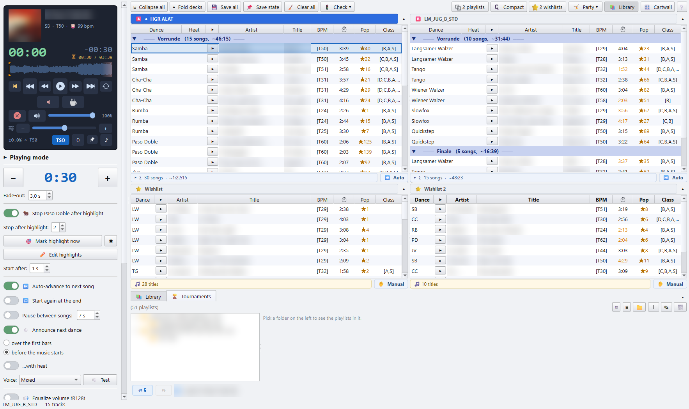
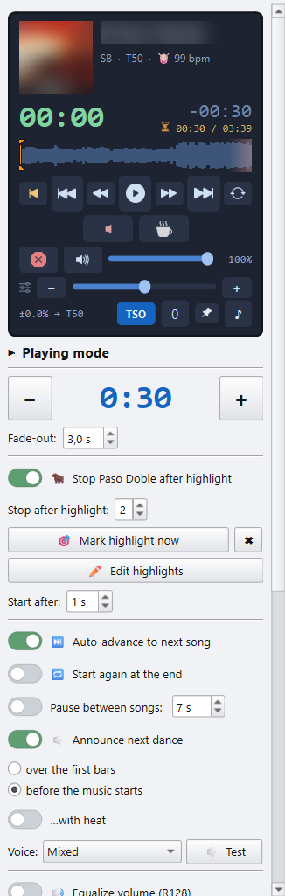
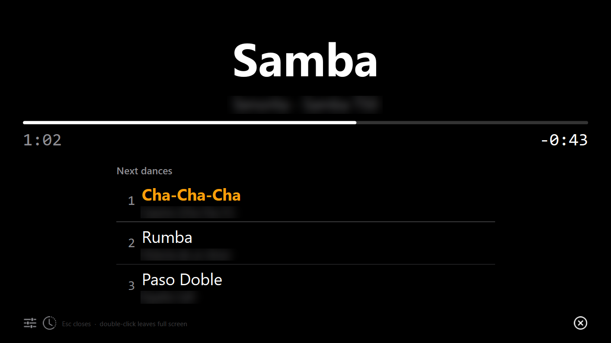
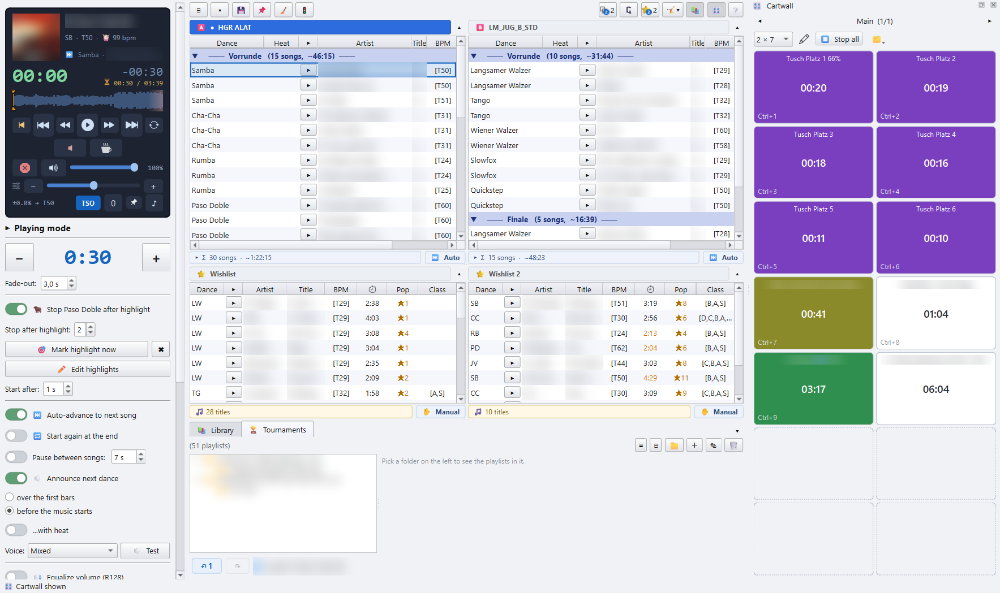
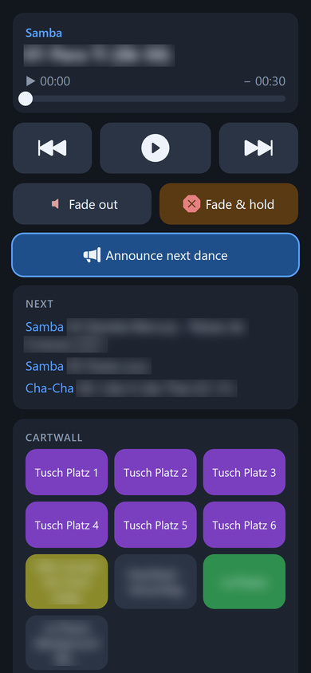
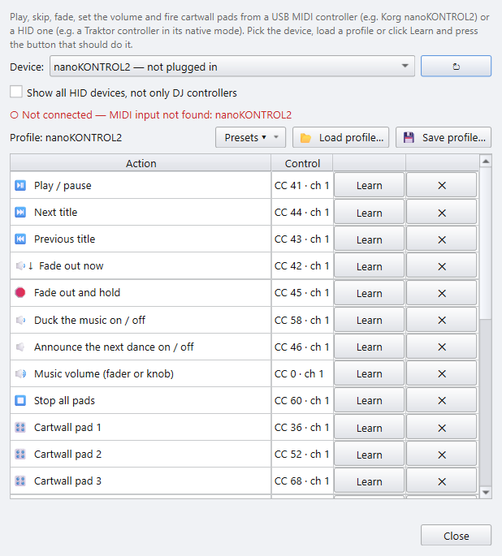

# 4 · Playing the evening

[Manual index](README.md) · previous: [Playlists](03-playlists.md)

The side panel holds the player card and, under it, the Playing panel. You
play straight from the decks, the Party panel and the wishlists.

## 🚦 Ready? before the evening

**🚦 Check ▸ 🚦 Ready?** in the toolbar checks every deck that holds titles,
and the Party list, in one go. It shows one traffic light per check and an
overall verdict: 🟢 *Ready*, 🟡 *Playable, with loose ends* or 🔴 *Not
ready, some titles will not play*.

| Line | Checks |
|---|---|
| 📁 Music files | Every file is there. A drive that is not plugged in is named as such. Titles that are not on the Reference path turn the line yellow. |
| 📊 Loudness | Every title is measured, so 🔊 Equalize volume can stay on. |
| 🔇 Silence probe | Every title is probed, so its silent edges are skipped. |
| 🐂 Paso Doble highlights | Every Paso Doble knows its highlights. |
| 🔁 Duplicates | No title is in two lists. |
| 🎶 Playlists | There is something to play at all. |

A line that is not green has a button that fixes it: **📊 Measure
loudness…**, **🐂 Find highlights…** or **🔁 Resolve duplicates…**.
**🧭 Fix paths…** stands on the 📁 Music files line every time, green or
not. The window stays open while a fix runs; **↻ Check again** grades anew.
The full app adds a 🎵 Music check line for tempo, length and round
structure.

## Starting a title

- **▶** in a row plays exactly that title. **■** stops it.
- **Space** pauses and resumes the player, wherever the focus is, except in a
  text field.
- **Double-click** a row either starts it at once, or only *cues* it: it is
  loaded and shown, silent, and ⏯ starts it. The switch for this is
  **▶️ Double-click starts the title** in the Playing panel, see below.
- **Ctrl + Shift + ← / →** jumps to the previous or next title, and
  **Ctrl + ← / →** seeks 30 s.

Every deck has its own **✋ Manual / ⏭ Auto** switch in its bottom bar:

- **⏭ Auto**: a finished title is followed by the next row, so a whole round
  runs hands-free.
- **✋ Manual**: you start every title yourself. The spoken announcement is off
  as well.

Each list remembers its own answer. The party list can run by itself while the
competition deck next to it is started by hand.

### A title that won't play

When a file is damaged or gone, the player does not leave the floor in
silence: it names the title in a short message, turns its row red with the
reason in the tooltip, and starts the next title of the same round. At the
end of a round it stops, as it would after any last title. The mark goes as
soon as the file plays again.

## The player card

The card at the top of the side panel shows the running title, its dance and
the time left.

| Control | Does |
|---|---|
| **\|◀** | Jumps back to 0:00 of this title. |
| **⏮ / ⏭** | Previous / next title. |
| **◀◀ / ▶▶** | Back / forward 10 s. |
| **⏯** | Pause / resume. |
| **🔁** | Repeats *this* title endlessly, for when the floor is still full or a speech runs long. It works with ⏭ Auto off, too. |
| fade button (muted speaker) | Fades the title out now, over the fade time, then ends it. |
| **☕** | Ends the title and goes straight to the pause music. |
| extend button | Adds another pause length when the heat change takes longer. |
| **⊗** | Panic: fades the music out and *holds* it. Nothing ends and nothing advances. **⏯** resumes at exactly that spot. |
| **🔊** | Ducks to 20 % and back to full. The pause music comes down too. |
| volume slider | Master volume. |

### 〰 The waveform

Below the time sits the running title's **waveform**: the quiet passages,
the silence that is skipped, the Paso Doble highlights and where the
fade-out of a timed cut begins. In the last seconds it turns red.

- **Click** it to jump to that spot. **Drag** along it to scrub: the playhead
  and the times follow the mouse, and the music jumps when you let go. A drag
  off the left edge goes to 0:00.
- By default the waveform replaces the seek bar, which covers the same
  stretch. Two switches in the Playing panel, under *Sound and display*,
  change that: **〰 Show waveform** and **…replace seek bar**. With the
  waveform off, the seek bar always comes back.

The tempo row under it:

- **Tempo fader**: −16 % to +16 % without changing the pitch (time stretch),
  for example to pull a title onto the tempo the tournament needs. **− / +**
  step it, hold them to glide. **0** or a double-click on the fader resets it.
- **TSO**: while on, every title is pitched to the average tempo of its dance
  in this round, kept inside the TSO range. A Rumba at 23 becomes T24, a Paso
  Doble at 57 becomes T58.
- **📌**: pins the tempo, so the fader stays where you left it when the next
  title starts.
- **♪**: tap along to the beat to measure the live tempo by hand. This is for
  display only and changes nothing.

## The Playing panel

### Play length and fade

- The big number is the **play length**: every title stops after this time.
  **− / +** change it in steps. Past the last step the title plays to its end
  (**full**). Double-click the number to type an exact length, for example
  `1:37`.
- **Fade-out**: the volume ramps to 0 over the last seconds.

Once the analysis has measured it, silence at the start and end of a title
is skipped.

### 🐂 Paso Doble

**🐂 Stop Paso Doble after highlight**: a Paso Doble is not faded out. It stops
at a highlight, the musical break the couples dance to.

- **Stop after highlight** picks which one, usually the 2nd.
- The highlights are detected by the analysis. When one is missing or wrong,
  click **🎯 Mark highlight now** exactly on the highlight while the title
  plays. **✖** forgets the learned marks of this title.
- **✏️ Edit highlights** pauses the music and suspends the stop, so you can
  scrub through the whole title and set its marks.
- **Start after** holds a Paso Doble back before the music starts, so the
  couples can take their position.

With the switch off, a Paso Doble is an ordinary title.

### Advance and pause

- **⏭ Auto-advance to next song**: the same switch as ⏭ Auto on the deck you
  last clicked.
- **🔁 Start again at the end**: after the last title, the list starts over.
  Needs auto-advance.
- **Pause between songs**: time for the couples to change or catch their
  breath. Off, the next title follows at once.
- **Pause music**: 📂 picks one or more titles, or an `.m3u`, that play during
  the pause. ✕ removes it. **Pause music volume** sets how loud it plays.

### 🔈 Announce next dance

The app says the next dance out loud: "Nächster Tanz: Langsamer Walzer".

- With a pause, the call comes shortly before the pause ends.
- Without a pause, the dance is named as the title starts: **over the first
  bars** (the music is ducked under the voice) or **before the music starts**
  (the music follows the call).
- **Voice**: Female, Male, or Mixed, which alternates the two. A dance that
  was never recorded is not announced.
- The call is in German on a German screen, and on an English one with
  **Keep the German dance and round names** ticked. Otherwise it is English
  ("Next dance: Slow Waltz"); a clip missing from the English recordings is
  played from the German ones.
- With the advanced voice controls on (⚙ Settings ▸ 🔊 Sound & player),
  **…with heat** adds the heat number. **🔈 Test** speaks a sample.

### Sound and display

- **🔊 Equalize volume (R128)**: levels the loudness between titles. It needs
  the loudness analysis.
- **🖼 Show artwork**: a cover next to the title on the player. It uses the
  playlist's own image (`#EXTIMG`), a cover file in the folder, or the art in
  the MP3.
- **〰 Show waveform** and **…replace seek bar**: the waveform on the player
  card, see [above](#-the-waveform).
- **▶️ Double-click starts the title**: on, a double-click plays at once. Off,
  it only cues the title and ⏯ starts it. That is what a heat wants.
- **↩ Remember where a title stopped**: a title you left starts again at that
  spot. The row shows **↩ mm:ss**. The marks are forgotten when the app
  closes.

### Play sets

Two buttons switch the whole panel over in one go:

- **🏆 Tournament set**: 1:40 play length with a 3 s fade-out, no pause, no
  auto-advance, no announcement, equalized volume. It is lit gold while the
  panel is on those values.
- **🎉 Party set**: every title at full length with a 3 s fade-out,
  auto-advance, no pause, no announcement and equalized volume. It is applied by itself when you play
  from the 🤸 Party panel, and switched back when a tournament deck takes
  over.

What each set contains is yours to change, in
[⚙ Settings ▸ 🎛 Play sets](06-settings.md#play-sets).

### 🖥 Presenter

**🖥 Presenter** opens a second, full-screen window for a beamer or a monitor
turned towards the floor. It shows the running title with its dance and the
next three titles.

- The box next to it picks the screen.
- **🎨 Theme**: *Default* is the black hall display. *Light* is cream paper
  with warm brown type, for a lit room.
- **🕒** holds a running order for the evening, such as dinner or the opening
  dance. It is a second page on the presenter. **T** there switches pages.
- **Esc** closes the presenter. A double-click on it leaves full screen.

**☀ Keep the screen awake** stops the screensaver and the display timeout
while music plays or the presenter is open.

## 🎛 The cartwall

**🎛 Cartwall** in the toolbar shows a wall of sample pads: fanfares, a
drum roll, the national anthem, a jingle for the award ceremony.

- **Click a pad** to fire it over the running music. Click it again to fade
  it out.
- **Ctrl + 1 … 9** fire the first nine pads of the page on screen.
- **⏹ Stop all** or **Esc** fades every pad out.
- **✏** unlocks the wall for building. Drop audio files on a pad to fill it.
  A multi-select fills the free pads after it. Drag one pad onto another to
  swap them. Lock the wall again before the tournament, so nothing moves by
  accident.
- **Right-click a pad** for its 🎨 colour, or **Settings…** for its label,
  volume, own shortcut key, 🔁 endless repeat, and whether it ducks the music.
- The page arrows switch pages. Double-click the page name to rename it. The
  size box sets the grid, for example 2 × 7. A smaller grid never loses a pad.
- **🗂** exports or imports the wall, or packs all pads onto one page.
- Drag the wall to the left or right of the window, below the decks, or out
  as its own window. **📌** snaps a floating wall back.

## 📱 The phone remote

The phone remote runs the desk from a phone's browser, on the same network
as the PC. There is no app to install. From the phone you can:

- see what is playing and what comes next;
- play and pause, go to the previous or next title;
- fade out, or fade out and hold;
- switch **🔈 Announce next dance** on or off. It is the same switch as on
  the Playing panel, so its voice and timing follow;
- drag the progress bar to seek. The spot under your finger is the spot the
  floor hears;
- fire the pads of the cartwall page on screen, or stop them all.

**To start it**, click **📱 Phone remote…** in the Playing panel, or
**📱 Start Server** in ⚙ Settings ▸ ⚙ General. The remote's window opens:

- **● Running / ○ Stopped** with **▶ Start / ■ Stop**;
- a **QR code**: scan it with the phone's camera and the phone is in, without
  typing the PIN;
- the address, with a picker when the PC is on more than one network, and a
  link that opens the remote in this PC's browser as a quick test;
- the **PIN** and **New PIN**, which a running server takes at once;
- a **log** of what reached the server: phones that opened the page, logins,
  wrong PINs and every command.

While the server runs, the status bar carries a green **📱 LIVE** badge; a
click on it brings the window back. In ⚙ Settings the button then reads
**📱 Stop Server**.

- Only phones on the local network get in, and only with the PIN. Wrong PINs
  lock a phone out for a while.
- The first time, Windows may ask whether the app may use the network. Allow
  it for private networks. If nothing turns up in the log while the phone
  tries, a firewall is in the way; the window names the program to allow.
- The server runs only as long as the app. Every start begins without it.

## 🎛 A hardware controller

A USB MIDI or HID controller can run the desk with real buttons and a fader.
Set it up in ⚙ Settings ▸ ⚙ General ▸ 🎛 Controller ▸ **🎛 Set up…**.

The actions it can take:

- ⏯ Play / pause, ⏭ Next title, ⏮ Previous title;
- 🔉↓ Fade out now, 🛑 Fade out and hold;
- 🔉 Duck the music on / off, 🔈 Announce the next dance on / off;
- 🔊 Music volume, from a fader or a knob;
- ⏹ Stop all pads, and sixteen cartwall pads: pad *n* is the *n*-th pad of
  the page on screen, as with **Ctrl + *n***.

In the window:

1. Pick the controller under **Device**. **↻** looks for new ones. Tick
   **Show all HID devices, not only DJ controllers** if yours is not listed.
2. **Presets ▾** holds a ready profile for the Korg nanoKONTROL2.
3. For any other controller, click **Learn** next to an action and press the
   button, or move the fader, it should answer to. **✕** unbinds an action.
   The line under the table shows the last control you touched.
4. **💾 Save profile…** and **📂 Load profile…** keep a mapping as a file,
   for example to take it to the venue PC.

The controller is applied as you set it and remembered. When it is unplugged,
the app looks for it again every few seconds. MIDI works on Windows, macOS
and Linux.

## 📜 Played titles

In playing mode the app writes down every title once it has run for 10
seconds, the moment its row greys out, with its start time, artist, dance and
list. Pre-listening while you plan is never logged. **❔ ▸ 📜 Played titles…**
lists the evenings, newest first; a break of more than four hours starts a
new one, so a party past midnight stays one evening.

- Click an evening to see its titles and how long each one ran.
- **💾 Save as CSV…** saves the evening as a table for Excel, for example
  for a GEMA report: date, start, artist, title, dance, list and duration.
- **🗑 Delete evening** removes it from the log after asking.

Next: [Tags](05-tags.md)
