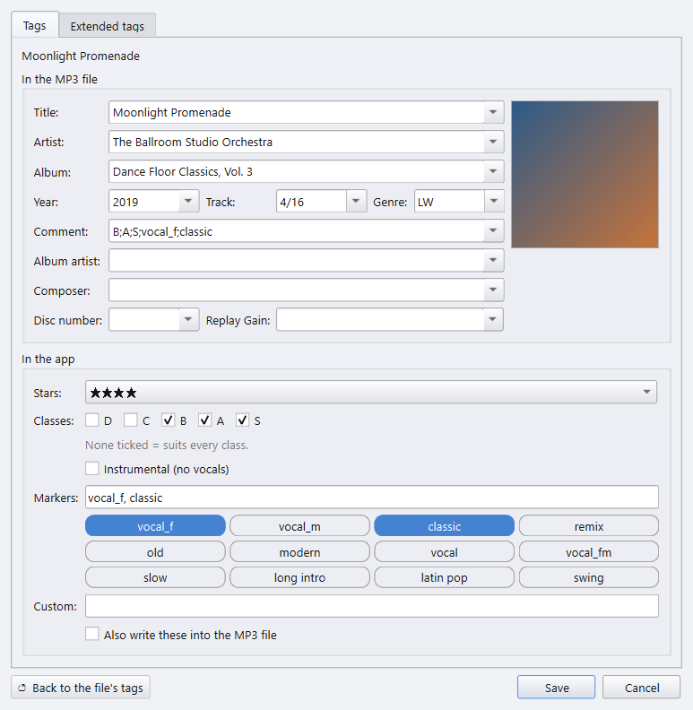

# 5 · Tags: stars, classes and the MP3 editor

[Manual index](README.md) · previous: [Playing the evening](04-playing.md)

Most of what the app knows about a title comes from its MP3 tags: the class
tags and markers in the comment, the title and artist. The **🏷 tag editor**
changes them without a second program. It also edits the MP3's own fields
the way Mp3tag does.

A tag lives in one of two places:

- **In the app**: stars, classes, instrumental, markers and the Custom field.
  A change is stored in the app's database, not in the file. It wins over
  the file's own tag and shows on every copy of the same file, in every deck
  and in the library.
- **In the MP3 file**: title, artist, album and the other ID3 fields. A
  change is written into the file itself.

## Opening the editor

Right-click a title in a deck, a wishlist or the 📚 library ▸
**🏷 Edit tags…**. If several titles are selected and you click inside the
selection, the entry reads **🏷 Edit tags of n tracks…** and edits them all
at once. The window is called **🏷 Tags**.

A double-click on a title in 📚 the library or a 🏆 tournament list opens it
too, when ⚙ Settings ▸ 🔊 Sound & player ▸ **📂 Double-click on a title in
📚 the library** is set to **Edit tags**. It then opens on the field of the
column you double-clicked, framed in the accent colour with its text
selected, so you can type straight over it: **Title**, **Artist**,
**Album**, **Comment**, **Genre** for the Dance column, **Classes** or
**Custom**. A column with no field of its own, such as BPM, opens the
editor as usual.

## The Tags tab

### In the MP3 file

A form like Mp3tag's: **Title, Artist, Album, Year, Track, Genre, Comment,
Album artist, Composer, Disc number** and **Replay Gain**, plus the front
cover (shown, not editable). A changed field is written into every selected
MP3 on **Save**. It is greyed out when the MP3's tags can't be read.

A selection with no MP3 on disk, only FLAC, M4A and the like, gets
**In the app's database** in this place instead: **Title, Artist, Album,
Year, Genre** and **Comment**. They are kept in the app's database like the
stars and laid over what the file says, so the file itself stays untouched.
A double-click in 📚 the library opens on the column's field here too.

With several titles, a field they differ in reads **< keep >** and stays as
it is in each file until you change it. **< blank >**, or an emptied field,
deletes the field from the files.

### In the app

- **Stars**: no stars, or one to five ★.
- **Classes**: the start classes D to S the title suits. None ticked means it
  suits every class.
- **Instrumental (no vocals)**.
- **Markers**: free markers such as `classic` or `vocal_f`, separated by
  commas. The library's most-used markers sit below the line as buttons.
  Click one to add it, click it again to take it out. A lit button is set.
- **Custom**: a free text per title, see [The Custom field](#the-custom-field).

With several titles, a field they differ in starts on *keep*: a half-ticked
class box, the stars on *keep (differs per track)*, an empty marker line. Only
what you change reaches them. Ticking **B** on three titles adds B to the
classes each one already has. A marker line typed for several titles
replaces their markers.

**↺ Back to the file's tags** forgets every change made in the app for these
titles and reads the MP3 again.

### Writing the app's tags into the MP3

The last line of the box, **Also write these into the MP3 file**, decides
where Save puts changed stars, classes, instrumental and markers. It starts
unticked every time the editor opens: the change then stays in the app only.
Ticked:

- the stars go into the Windows rating of the file, which Explorer and
  Windows Media Player show;
- the classes, *instr* and the markers go into the plain comment. Text the
  comment already holds stays there.

After that the file holds the tags, and the app keeps no separate change.

## The Extended tags tab

It lists every ID3 frame of the selected MP3s, including the ones the form
doesn't show: UltraMixer's custom text frames, MediaMonkey's comments, the
Windows rating. With several tracks, a value they differ in, or that only
some of them have, reads **< keep >** and stays as it is in each file
until you type over it. A typed value goes into every selected MP3, added
where a file doesn't have the frame yet; a removed frame goes from every
file that has it.

- Edit a value in the table. **➖ Remove selected** deletes the selected
  frames, **➕ Add field** adds one. Pictures and other binary frames can
  only be removed.
- The frames the form shows are read-only here and follow the form as you
  type.
- A frame's description can't be changed, but you can copy it: double-click
  it, or right-click any cell ▸ **📋 Copy**.
- Right-click a row ▸ **🏷 Fill Custom from this tag** maps the Custom field
  to that frame, see below.

Everything is written into the file on **Save**. The file keeps its tag
version, so an ID3v2.3 tag stays v2.3.

A title that is playing or paused in the player is not written. Stop it
first. A title that is only cued is written and loaded again.

## The ★ column

Decks, wishlists and the library have a **★** column. It is hidden at first:
right-click the column header to show it.

- Click the third star to rate the title 3. Click the star the rating ends
  on to clear it.
- A click on the stars is stored in the app at once and asks nothing.
- A double-click on the stars neither plays the title nor opens the file.

Ratings already in the file are read on the scan: the Windows rating of
Explorer and Windows Media Player, and a Songs-DB comment such as `ab C`
(class C and up), which becomes the classes C, B, A and S.

## The Custom field

One free text per title, typed in the 🏷 editor. It has its own **Custom**
column in the decks and the library, hidden at first like the ★ column.

The field can also show an MP3 tag of your choice, for example the date
UltraMixer last played a title. Right-click a column header ▸ **Map Custom to
an MP3 tag…**:

- **Frame**: *In the app only* (the default), or the kind of tag, such as a
  custom text (TXXX) or a comment. Both ID3v2.3 and v2.4 tags are read.
  **Comment of the old tag (ID3v1)** reads the comment of an ID3v1 tag,
  which older files may carry alone. It is read only: Save never writes
  into it, because it holds just 28 characters and often the classes.
- **Description**: which custom text or comment, for example
  `ultramixer_last_played`. The list offers the descriptions that a sample of
  80 MP3s of your library really holds, the most common first. A grey line
  says how many of them hold the chosen one, with an example value.

After **OK** the app reads that tag of every library title in the
background and fills the column. A value typed in the 🏷 editor still wins
over the tag. While Custom is mapped, **Also write these into the MP3 file**
takes it into that tag too. Without a mapping, Custom never touches the file.

The quicker way: open the 🏷 editor on a title that has the tag, go to
**Extended tags** and right-click the row ▸ **🏷 Fill Custom from this tag**.

Next: [Settings](06-settings.md)
