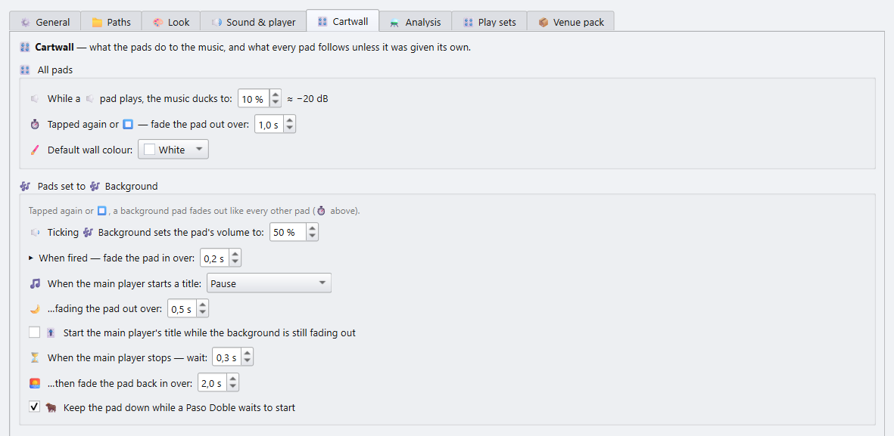

# 6 · Settings

[Manual index](README.md) · previous: [Tags](05-tags.md)

Open **⚙ Settings** from the bottom of the Playing panel. The changes apply
when you click **OK**. Theme, accent colour, language and the audio backend
are read at start: for those the app asks for a restart.

The tabs, in order: **⚙ General**, **📁 Paths**, **🎨 Look**, **🔊 Sound &
player**, **🎛 Cartwall**, **⚗ Analysis**, **🎛 Play sets** and **📦 Venue
pack**. The full app adds **🎵 Checks**, the thresholds of its music check;
the player hides it. Opened again, the settings come back on the tab they
were closed on, until the app is closed.

## General

The **⚙ General** tab.

| Setting | Does |
|---|---|
| **App mode** | Which side of the app is shown: *Both*, *Planner only* or *Player only*. Switching back brings everything back. The player build has no such row. |
| **📱 Phone remote** | **📱 Start Server** starts the phone remote and opens its window on top of the settings. While it runs, the button reads **📱 Stop Server**. See [chapter 4](04-playing.md#-the-phone-remote). |
| **🎛 Controller** | **🎛 Set up…** opens the window for a USB MIDI or HID controller. See [chapter 4](04-playing.md#-a-hardware-controller). **⌨ Keys…** puts the same actions on keys and holds the cartwall's keys too, see [chapter 4](04-playing.md#-desk-keys). |
| **🐞 Send error reports** | Only in builds that can send them. When the app hits an error, it sends the technical details to the developer: the error, the last log lines, the system and the app version. Never your music or playlists. Off by default. |
| **🔔 Check for new versions** | Once per start, ask GitHub (api.github.com) whether a newer release is out, and announce it once with a link to its download page. The request carries nothing about you or your music; GitHub sees the IP address it comes from. Nothing is downloaded or installed. Off by default; the first start asks. Applies from the next start. |

## Paths

The **📁 Paths** tab.

The folders are described in
[chapter 1](01-getting-started.md#point-the-app-at-your-music). Among them
sits the **Playlist file format**: *UTF-8 (.m3u)*, *UTF-8 with BOM (.m3u)* or
*UTF-8 (.m3u8)*, see
[chapter 3](03-playlists.md#the-playlist-file-format).

**Excluded folders**, one per line (or picked with **Add…**), keep a folder
and everything below it out of the library: ⭐ Favorites and 🌐 Whole
library leave those titles out of the list, the search and the
suggestions. Nothing on disk changes. A change takes effect with the next
start, and the app offers to restart.

## Look

The **🎨 Look** tab.

- **🎨 Theme**: a list of every look, each with a picture of the main window
  in it beside the list.
  - **Standard**: the classic *Light*, the default, and *Dark* for a dim hall.
    They keep the emoji on the buttons and take the accent colour below.
  - **Platform looks**: Windows 11, macOS and Linux GNOME, each light and
    dark. Every look can be picked on every system.
  - **Desk looks**: *Console*, *Carbon*, *Neon* and *Studio*, dark like a
    mixing desk.
  - **Modern looks**: *Graphite*, *Midnight*, *Aurora*, *Paper* and two
    high-contrast looks, picked for readability first.

  A look restyles the buttons, fields, tabs and menus, brings its own font and
  accent colour, and swaps the button emoji for drawn icons. Warnings stay red
  in every theme.
  - **Own looks**: looks you make yourself, kept on this computer.
    **＋ New look…** copies the selected look (*Light* and *Dark* start from
    *Paper* and *Graphite*) and opens the editor: every colour, the corners, the
    button, tab and focus style and the font, with a live preview beside them.
    Text that reads too faintly against its ground is listed as a warning.
    **✎ Edit…** and **🗑 Delete** change or remove an own look, **Export…**
    saves one as a `.json` file and **Import…** adds one someone passed on.
    These buttons save at once. Changing the look the app runs in offers a
    restart when you close the settings with OK.
- **🎚 Accent colour**: the blue of the buttons, sliders and the player panel,
  for *Light* and *Dark*.
  **↺ Default blue** resets it. Colours that mean something, such as red
  warnings, keep their hue.
- **🌐 Language**: English, Deutsch, Español, Nederlands or Русский. Track
  names and anything read from your files stay as they are.
- **Keep the German dance and round names on a screen in another language**:
  *Langsamer Walzer*, *Vorrunde*, *Eintanzen* instead of *Slow Waltz*,
  *Round 1*, *Practice*. The presenter screen and the recorded announcements
  are then German too, and the tempo rules are named TSO instead of WDSF CR.

Theme, accent colour and language take effect after a restart.

- **⛶ Fullscreen clock: only the time (20:45:12), no date**: the clock in the
  status bar while the window is in [fullscreen](01-getting-started.md#-fullscreen).
  It changes within a second of saving.
- **🖥 Presenter screen**: the colours of the
  [presenter](04-playing.md#-presenter). *Default* is the black hall display.
  *Light* is cream paper with warm brown type, for a lit room. An open
  presenter changes as soon as you save.

## Sound and player

The **🔊 Sound & player** tab.

| Setting | Does |
|---|---|
| **🔊 Audio backend** | The engine every title is played through. On Windows: *FFmpeg* (the default) or *Windows Media Foundation*. Only change it when a title won't play or a tempo change leaves a gap. Takes effect after a restart. |
| **🔇 Release the sound card between titles** | An onboard sound card puts a hiss on the PA while an app holds it open. This hands the device back after a few seconds of silence. The price is a soft click when the next title starts, so switch it on only if you hear the hiss. |
| **🔕 Mute system sounds while the evening runs** | No error ding or notification chime over the speakers. The system sounds come back when you close the app. |
| **🎧 Preview player** | A mini player (seek, skip, volume) floats over the deck when you click a ▶ in a row. |
| **🖼 Show artwork** | A cover next to the title on the player card. It uses the playlist's own image (`#EXTIMG`), a cover file in the folder, or the art in the MP3. |
| **〰 Show waveform** | The title's [waveform](04-playing.md#-the-waveform) on the player card in place of the seek bar. |
| **🔉 Duck to** | How far 🔊 Duck pulls everything down on the player card, the mini player and the presenter screen: 20 % by default, 0 % (silence) to 90 %. A change reaches a duck that is on right now. |
| **🌅 Fade each title in over** | Off by default. The main player starts every title at silence and brings it up over 0.5 to 10 s of music. A title that a 🔀 crossfade brings in keeps its own ramp. Couples start on the first downbeat, so leave it off for a competition. |
| **⏩ Start each title this far in** | Off by default. The main player skips the first 1 to 30 s of every title, and those seconds don't count against the play length. A title picked up at its ↩ mark starts there instead, and a silent intro is still skipped on top. |
| **🎙 Announcement voice** | Who reads [🔈 Announce next dance](04-playing.md#-announce-next-dance): *Female*, *Male* or *Mixed* (the default), which alternates the two. **…with heat** adds the heat number, off by default. **🔈 Test** speaks a sample in the voice shown, before you click OK. |
| **🗣 Dance is named** | Where the call sits when a title names its dance as it starts, with no pause: **over the first bars** (the default; the music is ducked under the voice) or **before the music starts** (the music follows the call). The ▶ Playing panel names it in short: *over the music* or *before the music*. |
| **▶ Player position** | Where the player card stands: *beside the playlists*, at the head of the Playing panel, or *above the playlists*, as one wide strip over the decks. |
| **📂 Double-click on a title in 📚 the library** | Last on the tab, under **📚 Library**, since it is about the library, not the player. What a double-click does in 📚 the library and the 🏆 Tournaments lists while planning: **Nothing** (the default; ▶ plays the title), **Open external player** (the program your system plays music with, on a Mac Music; then also for a deck row while planning and in the dialogs) or **Edit tags** (the [🏷 Tags editor](05-tags.md#opening-the-editor), opened on the field of the column you double-clicked; you choose there what Save writes into the file). While planning, a double-click on a deck row plays the title in the mini player unless *Open external player* is chosen. Right-click offers all of it either way, and in Playing mode a double-click always plays or cues the title. |

### 🔈 Outputs

Where each part of the evening is heard. Every output the operating system
lists can be picked, on Windows, macOS and Linux.

| Output | Plays |
|---|---|
| **🎵 Music** | The titles. *System default (follows the OS)* goes wherever Windows sends its sound. |
| **🎧 Pre-listen** | ▶ in the 📚 Library and the 🏆 Tournaments pane, with a mini player of its own, while the music runs on. See [chapter 4](04-playing.md#-pre-listening-on-headphones). |
| **🎛 Cartwall** | The pads. |
| **⏸ Filler music** | The pause music. |
| **🔈 Announcements** | The spoken calls. |

- Every output except the music starts on **Same as the music**. *System
  default* pins one to the default while the music plays elsewhere.
- On a sound card with several outputs, each pair the system shows as a
  device of its own ("Out 3/4" next to "Out 1/2") can take a source of its
  own. Channels 3/4 of *one* multichannel device cannot be picked apart.
- A card that is not plugged in plays on the system default, with one
  message, and the sound goes back to the card when it is back. The
  pre-listen is the exception when that default is the music's output: it is
  refused, so nothing meant for the headphones reaches the PA. With one
  output only, there is no other to choose, and the pre-listen plays there.
- Windows sometimes gives a replugged card a new number, so
  `2- ESI Audio Device` comes back as `3- ESI Audio Device`. The app then
  finds the card again by its name, as long as only one plugged-in card
  has it.
- While the card chosen for the 🎵 music is plugged in, the status bar
  shows a small **🔊** with its name. A click on it opens this tab.
- The choice applies when you click OK, without a restart.

## Cartwall

The **🎛 Cartwall** tab holds what every pad of the
[🎛 cartwall](04-playing.md#-the-cartwall) follows unless it was given its
own. *Planner only* mode hides it.

| Setting | Does |
|---|---|
| **🎛 A pad ducks the music to** | How loud the music stays while a cartwall pad that pulls the music down plays: 10 % by default (about −20 dB, so a fanfare cuts through), 0 % (silence) to 90 %. Like 🔉 Duck to on the 🔊 Sound & player tab, it is a share of the music's volume, not of its loudness; the dialog shows the dB next to it. |
| **🎶 Background pads when a title starts** | What a 🎶 Background pad does once the music starts: **Mute and keep playing** (the default; it runs on silently and fades back in when the music stops) or **Pause** (it holds where it was and carries on from there when the music stops). |
| **⏱ Pads fade out over** | How long a pad takes to let go when it is clicked again or ⏹ Stop all fades the wall: 1 s by default, *cut* up to 8 s. **Own fade-out** in a pad's **Settings…** overrides it for that pad. |
| **🖌 Default wall colour** | The colour of every pad left on 🎨 Colour ▸ **Wall default**: white by default. A pad given a colour of its own keeps it. |

The fade-out and the colour belong to the wall rather than to the PC, so a
cartwall carried to another PC in a [venue pack](#venue-pack) brings them
along.

## Analysis

The **⚗ Analysis** tab collects every analysis. It only *reads* your files.
Everything is cached, so a second run only does what is new.

The player needs three of them:

- **📊 Analyze loudness (R128)**: for *Equalize volume*.
- **🐂 Analyze PD highlights**: for the Paso Doble stop.
- **🔇 Probe silences**: for skipping silence at the start and end.

**📤 Export / 📥 Import manual PD marks** carries the highlights you marked by
hand to another PC. Run from the full app, the tab lists more analyses; the
player build shows only these.

The hand-set PD marks, the tag edits made in the app and the log of
[played titles](04-playing.md#-played-titles) are the only data no analysis
can find again, so the app backs them up by itself: on the first
start of each day it writes a small file to the `backups` folder next to its
database, brings it up to date when the app closes, and keeps the last seven.
**Backup folder** sends them elsewhere instead, for example a Dropbox folder,
so they live off this PC; each PC writes into a subfolder named after it.
**♻ Restore user data backup…** merges one
of them back in; it takes effect after a restart.

**🧱 Build ALL caches…** runs every analysis in turn, for a library you
choose. It can be cancelled.

**🧹 Clean up database…** removes cached rows for files that no longer exist
and compacts the database. It refuses to run when the music drive looks
unmounted, so the analysis can't be wiped by accident.

**🗑 Reset database…** empties chosen parts of the database and restarts the
app. A dialog asks which, with nothing ticked: **🏷 Tags read from the music
files** (the next library scan reads them again, minutes), **🎚 Audio
analysis** (⚗ Analysis builds it again, hours) and **✋ My own data** (tag
edits, hand-set PD marks, the 📜 play log). Your own data is backed up first
whatever you pick, so **♻ Restore user data backup…** brings it back.

## Play sets

The **🎛 Play sets** tab sets what the **🏆 Tournament set** and **🎉 Party
set** buttons of the Playing panel apply (see
[chapter 4](04-playing.md#play-sets)).

A list that stands on a set follows it when you change the set here: every
value it still has from the set takes the new one, and a value you changed by
hand on the list stays. The decks follow the 🏆 set, the 🤸 Party panel the 🎉 set.

For each set:

- **Play length**: pick one, type `m:ss` or seconds, or choose *full*.
- **Fade-out**, in half-second steps, and **within the length**: ticked, the
  fade ends at the play length; unticked, it comes after it. The 🏆 set's
  per-dance lengths follow it too. Out of the box the 🏆 set fades after the
  length, the 🎉 set within it.
- **🔀 Crossfade**: a switch, and 0.5 to 10 s in half-second steps, with the
  same curve button (equal power, linear or S-curve) and picture as on the
  Playing panel. Off in both sets out of the box, at 4 s with equal power
  once switched on.
- **⏭ Auto-advance**, **⏸ No pause between songs**, **🔈 Announce next
  dance**, **🔊 Equalize volume**, **▶️ Double-click starts the title**,
  **❓ Ask before a double-click stops the title** and
  **🎚 WDSF CR pitch to the heat tempo**.

The tournament set also has one list of lengths per dance, with a selector
on top, **⏱ Lengths**: **Per dance — the standard** or **Per round —
overrides it**. Only with per round does a second box appear, for the kind
of round: the first round, the intermediate rounds (one setting for all of
them), the semi-final or the final. The list below shows the lengths of that
choice. Both count, whichever one is on screen.

- **Per dance**: leave a dance on *— the set's length*, pick *full* or a
  step, or type `m:ss`. A dance with its own length is cut there while a
  list plays the 🏆 set's length, whatever its other switches say. Out of
  the box: 1:30 for the Waltz, Viennese Waltz, Quickstep and Jive, 1:37 for
  the Tango, Slow Foxtrot, Samba, Cha-Cha-Cha and Rumba, and the Paso Doble
  in *full*.
- **Paso Doble**: *full*, or *after highlight 1* or *2*. A timed cut
  would end it in the middle of a phrase, so there is nothing else, and a
  3rd highlight comes so late that it reads as *full*. A highlight ticks
  **🐂 Paso Doble: stop after highlight** of the tournament set and sets
  which one; *full* unticks it. Ticking the box moves this pick along.
  Each per-round list has its own Paso Doble pick: on *— the dance's
  length* it runs as set here; *full* or a highlight overrides that in this
  kind of round, so a final can run in full and a first round stop after the
  2nd highlight. Like a round's length, it counts only while the list plays
  the 🏆 set's length.
- **Per round**: a dance can run a different length in that kind of round,
  every heat of it alike. A dance left on *— the dance's length* plays its
  per-dance length, and out of the box every one is left that way. Where a
  round has its own length, the Playing panel names the round under the
  digits, e.g. *Viennese Waltz, Final — its own length*. A list without
  rounds, such as a party list, only uses the per-dance lengths.

Both sets also carry the 🐂 Paso Doble: **stop after highlight** (and which
one) and **Start after**. Out of the box the tournament set has the stop
off, since the detection is not reliable enough to cut a competition Paso
Doble, and Start after at 0 s. The party set stops after the 2nd highlight
and waits 3 s, so the couples can take their position.

**🎚 WDSF CR pitch target** sits right under the tournament set. It sets,
per dance, the tempo the CR button pitches a heat to:

- **Middle of the round**: puts the whole round on one tempo, where most of
  its titles already are. No title moves more than one bar per minute.
- **Lower / Middle / Upper**: a fixed tempo within the WDSF CR range. This
  is worth setting for the slow dances, where one bar per minute is a much
  bigger pitch change.

With the German dance and round names kept (⚙ Settings → Language), and on a
German screen, these read TSO instead of WDSF CR.

## Venue pack

The **📦 Venue pack** takes the whole desk to another PC in one file: the
settings, every deck and wishlist, and the 🎛 cartwall with its pads and
keys. If you want, the music they use goes in too.

- **📦 Export venue pack…** writes the file. A progress window shows how far
  it is and can cancel it. The suggested name is `venue-<date>.dpvenue`, or
  `venue-<date>-with-music.dpvenue` when the music goes in.
- **📥 Import venue pack…** on the other PC loads it. It takes over the
  settings, decks and cartwall at the next start; what it replaces is kept in
  a `before-venue-import` folder next to them. Music in the pack is unpacked
  into a folder you pick, and every deck and pad is pointed at it.

Folder settings, such as the library, playlist and save-as folders, the
presenter screen and the audio backend, stay with each PC.

Next: [Keyboard and mouse](07-shortcuts.md)
