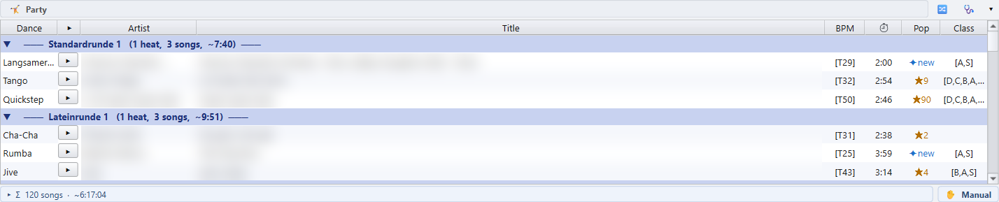
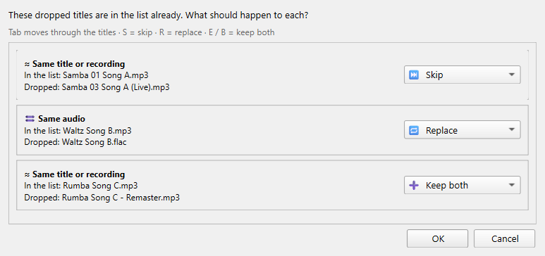

# 3 · Wiedergabelisten

[Zurück zur Übersicht](README.md) · zurück: [Bibliothek und Turniere](02-library-and-tournaments.md)

Der Player hält seine Musik in drei Arten von Listen:

- die **Decks**, eins pro Turnier oder pro Teil des Abends;
- den **Party-Bereich**, für einen langen Tanzabend;
- die **Wunschlisten**, für Titel, die du griffbereit halten willst.

## Die Decks

**⧉ *n* Listen** in der Werkzeugleiste legt fest, wie viele Decks auf dem
Bildschirm stehen. Jedes Deck ist ein **Ablauf**: die Titel laufen von oben
nach unten.

- Eine Turnier-Wiedergabeliste erscheint weiterhin nach Runden und Tänzen
  gegliedert. Ein Klick auf einen Runden- oder Tanzkopf klappt ihn zu.
- Jede Zeile lässt sich überallhin ziehen, auch in ein anderes Deck.
- Ein Titel, den du auf ein Deck ziehst, aus der Bibliothek, einer
  Wunschliste oder dem Explorer, wird dort **eingefügt**, wo du ihn ablegst.
  Er ersetzt nie den Titel, der dort stand.
- **Entf** nimmt die markierten Titel nach einer Rückfrage aus dem Ablauf.
  In einer Partyliste lautet die Frage **Mit Slot entfernen**, **Slot
  behalten** oder **Abbrechen**; Decks fragen mit Ja oder Nein. Danach steht
  die Markierung auf der Zeile, die an die Stelle nachgerückt ist (auf der
  neuen letzten Zeile, wenn der letzte Titel ging).
- **⬇ Ans Ende der Liste verschieben** im Rechtsklick-Menü einer Party-Liste,
  eines freien Ablaufs oder einer Wunschliste setzt den Titel ans Ende. Eine
  Markierung geht geschlossen mit.
- **Strg + Z / Strg + Y** machen jede Änderung rückgängig und wiederholen sie.
  Die Knöpfe ↶ / ↷ unten zeigen, wie viele Schritte es gibt.
- Ein Doppelklick auf den Decktitel benennt das Deck um. **▾** im Kopf klappt
  das Deck zu einem Reiter ein.

Die Spalten:

- **Tanz / Gruppe**: welcher Tanz und welche Gruppe die Zeile ist.
- **▶**: spielt oder stoppt genau diesen Titel.
- **Titel**: das Titel-Tag der MP3. Eine Datei ohne zeigt ihren bereinigten
  Dateinamen.
- **BPM**: das Tempo in Takten pro Minute. Es wird zuerst aus dem Dateinamen
  gelesen (`[T51]`), dann aus dem BPM-Tag der MP3, dann aus einem Tempo im
  Titel-Tag. Ein BPM-Tag zählt Schläge, darum wird es in Takte pro Minute
  umgerechnet, und es zählt nur, wenn es nahe am TSO-Bereich des Tanzes
  landet. Der Tooltip der Zelle sagt, woher das Tempo kommt. `[?BPM]` heißt,
  die Datei trägt kein Tempo.
- **⏱**: die Länge. Sie ist **orange**, wenn der Titel kürzer ist als die
  Spieldauer oder wenn an einem Rand 5 s oder mehr Stille übersprungen werden.
- **Pop**: `★58` heißt, der Titel steht in 58 deiner Turnier-Wiedergabelisten.
  **✦neu** heißt, er steht in keiner.
- **Klasse**: die Klassen-Tags aus dem MP3-Kommentar, zum Beispiel `[B,A,S]`.

Fünf weitere Spalten sind anfangs ausgeblendet. Ein Rechtsklick auf den
Spaltenkopf blendet sie ein: **★** bewertet einen Titel mit einem Klick,
**Custom** hält einen freien Text pro Titel, **Dateiname** zeigt den
bereinigten Dateinamen, mit dem vollen Pfad im Tooltip, **Album** den
Album-Tag der MP3 und **Kommentar** ihren Kommentar, wie er drinsteht (etwa
„vocal AS“). ★ und Custom
beschreibt [Kapitel 5](05-tags.md).

**Gespielt** (ebenfalls anfangs ausgeblendet) zählt, wie oft ein Titel in den
letzten 24 Stunden gespielt wurde, aus jeder Liste: „2“ in jeder Liste, die
ihn enthält, egal wo er lief. Ein Titel zählt, sobald er im Spielmodus 10
Sekunden zu hören war, dieselbe Regel wie bei 📜 Gespielte Titel. **Zähler
für Gespielt zurücksetzen** im Rechtsklick-Menü des Spaltenkopfs setzt alle
Zähler auf null; 📜 Gespielte Titel behält trotzdem jeden Titel. Die
Bibliothek und die 🏆 Titelliste haben dieselbe Spalte.

**Gespielte Titel zurücksetzen (grau)** im selben Menü nimmt das Grau aus
allen Listen, ohne Neustart. Zähler und 📜 Gespielte Titel bleiben, wie sie
sind, und ein laufender Titel, der schon zählt, bleibt gespielt.

Zieh einen Spaltenkopf zur Seite, um die Spalte zu verschieben. Die neue
Reihenfolge gilt für alle Listen dieser Art (alle Decks, alle Wunschlisten
oder alle Partylisten) und bleibt beim nächsten Start erhalten. **Tanz**
bleibt vorne und **↺** hinten. Ein eingeblendetes **Album** steht anfangs
direkt hinter **Titel**.

Zeilenfarben:

- eine **orange** Zeile ist markiert, zum Beispiel als Titel, der
  später getauscht werden soll (**Strg + M**);
- eine **hellrote** Zeile mit ❗ auf dem ▶ zeigt auf eine Datei, die es nicht
  mehr gibt. Ist die Datei wieder da und läuft der Titel, verschwindet die
  Markierung. Ein Titel, der sich nicht abspielen ließ, wird genauso rot, mit
  dem Grund im Tooltip, siehe
  [Kapitel 4](04-playing.md#ein-titel-der-nicht-spielt);
- eine **fliederfarbene** Zeile mit **📌** vor dem Titel ist angeheftet.

**📌 Einen Titel anheften.** Rechtsklick auf einen Titel einer Runde ▸
**📌 Anheften — Titel beim Neuwürfeln der Runde behalten**. Wird die Runde
oder ihr Tanz auf der Planerseite neu erzeugt, behält ein angehefteter Titel
seinen Platz; das Neuwürfeln seiner eigenen Zeile meldet, dass er angeheftet
ist, statt ihn zu ersetzen. **📌 Lösen** nimmt die Nadel wieder heraus.
Angeheftetes wird mit dem Deck gespeichert und geht, wenn das Deck geleert
wird.

Die Leiste unter dem Deck zeigt die Zahl der Titel **Σ** und die
Gesamtzeit. Ein Klick auf ▸ zeigt die Zahl pro Tanz. Der Schalter
**✋ Manuell / ⏭ Auto** legt fest, ob das Deck von selbst weiterspielt, siehe
[Kapitel 4](04-playing.md#einen-titel-starten).

Ein Rechtsklick auf einen Titel bietet **🏷 MP3-Tags neu einlesen**,
**🏷 Tags bearbeiten…** (siehe [Kapitel 5](05-tags.md)),
**📋 Dateipfad kopieren**, **📂 Im Explorer zeigen**,
**↩ Zeitmarke zurücksetzen** (nur bei einem Titel mit Zeitmarke) und die
Einträge zum Speichern und Importieren weiter unten.

## 🤸 Der Party-Bereich

Der Party-Bereich hält eine lange Liste für einen Tanzabend. Er sitzt
zwischen den Decks und den Wunschlisten. **🤸 Party ▾** in der
Werkzeugleiste blendet ihn ein oder aus, und **▾** in seinem Kopf klappt ihn
ein.

Eine Liste, die du hier öffnest, erscheint in voller Größe: Die Playlists
werden ausgeschaltet und eine Wunschliste bleibt. Der Playlist-Knopf in der
Werkzeugleiste holt sie zurück.

- Zieh eine `.m3u` auf den Bereich, um sie zu laden. Der Bereich trägt dann
  den Namen der Datei. Ein Turnierablauf, den du hier ablegst, wird in die
  Runden aufgeteilt, in denen er gespielt wird, etwa *Vorrunde* und
  *Finale*.
- Eine in Runden gebaute Liste ist nach ihnen gegliedert, zum Beispiel
  *Standardrunde*, *Lateinrunde* und *Socialrunde*.
- **⇅ Diese beiden Titel tauschen** (Rechtsklick oder **Alt + S**) tauscht
  zwei markierte Titel desselben Tanzes, so behält jede Runde ihre Tänze.
- **🗑 Diesen Titel entfernen (Platz bleibt frei)** (Rechtsklick) lässt eine
  leere Zeile stehen. **🗑 Diesen Titel samt Platz entfernen** nimmt die Zeile
  mit heraus. Auch Decks bieten das an, wenn der Titel der einzige seines
  Tanzes in der Runde ist: Der Tanz verlässt dann diese Runde.

Spielst du aus dem Bereich, schaltet die App von selbst auf das
**🎉 Party-Set**: volle Länge, automatisch weiter, keine Pause, siehe
[Kapitel 4](04-playing.md#abspiel-sets).

### Ein Titel, den die Liste schon hat

Eine Liste hält jeden Titel nur einmal. Ziehst du einen einzelnen Titel auf ein
Deck oder den Party-Bereich, der ihn schon hat, fragt die Liste nach:

- **Ersetzen** holt den Titel von seinem alten Platz hierher. Landet er auf
  einem anderen Titel (ein Platz im Deck, oder **Umschalt** im Party-Bereich),
  fällt dieser aus der Liste.
- **Swap** vertauscht die beiden Titel.
- **Abbrechen** lässt die Liste, wie sie war.

Ein leerer Platz bietet statt der ersten beiden **Ersetzen** an (der Titel
zieht hierher). Ziehst du mehrere Titel auf einmal, werden sie gemeinsam
geprüft, siehe unten.

Die Frage sperrt die App nicht: Der Player bleibt bedienbar, die längeren
Hinweise stehen als Tooltips an den Knöpfen. **Ersetzen** und **Swap** lassen
die geänderten Zeilen etwa eine Sekunde blau aufblitzen (Ersetzen zeigt den
alten Platz und die Zeile, in der der Titel gelandet ist). Hat sich die Liste
inzwischen geändert, passiert nichts, und eine Meldung sagt es.

Im Spielmodus bietet ein Ablegen in einer Partyliste außerdem **Add** an: Der
Titel läuft hier und bleibt auch an seinem alten Platz. Ist er gespielt, werden
beide Zeilen grau, und eine graue Zeile läuft trotzdem, wenn sie an der Reihe
ist. Im Planungsmodus bekommt eine Liste nie eine zweite Kopie.

### Eine andere Aufnahme eines Titels, den die Liste hat

Dateien, die du auf ein Deck, eine Wunschliste oder eine Liste in freier
Reihenfolge ziehst, werden gegen die Liste geprüft, bevor etwas hinzukommt. Ein
Titel gilt als vorhanden, wenn die Liste dasselbe Audio, denselben Dateinamen
oder Titel, einen ähnlichen Titel (die Regel von **🔁 Doppelte prüfen**, also
passt „Friends and Lovers“ zu „Friends and Lovers Cut Version“) oder dieselbe
Aufnahme nach dem Klang hat (dafür braucht es `fpcalc`).

- **Ein solcher Titel**: ein Fenster mit **Ersetzen**, **Beide behalten** oder
  **Vorhandenen behalten**. Vorhandenen behalten verwirft die neue Datei.
- **Mehrere Titel**: ein Fenster mit einer Zeile je Titel, links die beiden
  Dateinamen, rechts die Wahl: **⏭ Überspringen** (Vorgabe), **🔁 Ersetzen**
  oder **➕ Beide behalten**. **Tab** läuft durch die Zeilen und umrahmt die mit
  dem Fokus. **S** überspringt, **R** ersetzt, **E** oder **B** behält beide,
  danach springt der Fokus zur nächsten Zeile. **OK** führt die Wahl aus,
  **Abbrechen** fügt vom ganzen Ablegen nichts hinzu.

Ersetzen setzt die neue Datei an die Stelle der alten und entfernt die alte.
Eine einzelne exakte Kopie wird still übersprungen. Der .m3u-Import behält sein
eigenes Duplikatfenster.

## ⭐ Wunschlisten

Eine Wunschliste ist eine flache Liste von Titeln, die du griffbereit halten
willst: Wünsche von der Fläche, ein neues Album, das du ausprobieren willst.

- Zieh Titel aus einem Deck, der Bibliothek oder dem Explorer hinein. Zieh
  sie hinaus auf ein Deck.
- **⭐ n Wunschlisten** in der Werkzeugleiste zeigt bis zu vier Wunschlisten
  oder ein 2×2-Raster.
- Ein Doppelklick auf den Titel benennt sie um. Zieh den Kopf einer
  Wunschliste auf einen anderen, um die beiden zu tauschen.
- Rechtsklick auf eine Wunschliste oder ihren Kopf ▸ **↔ Diese Wunschliste
  vergrößern**, oder **Strg + Umschalt + E**: Sie bekommt den ganzen Bereich,
  die anderen klappen zu Reitern ein. Derselbe Eintrag und dieselbe Taste
  öffnen wieder alle.
- Die Leiste darunter zählt die Titel und wie viele davon neu (nie gespielt)
  sind.

**🧹 Leeren** lässt die Wunschlisten stehen, solange du sie in der Rückfrage nicht anhakst.

## Laden und speichern

| Um | Tu |
|---|---|
| eine `.m3u` in ein Deck oder eine Wunschliste zu laden | Rechtsklick ▸ **📂 M3U importieren…**, oder zieh die `.m3u` darauf. Mehrere `.m3u` auf einmal gehen in die freien Decks, je eine. |
| ein [Hallenpaket](06-settings.md#hallenpaket) von einem anderen PC zu laden | Zieh die `.dpvenue`-Datei auf das Programmfenster, oder Rechtsklick ▸ **📥 Hallenpaket importieren…**. Das ist dasselbe wie in den ⚙ Einstellungen. |
| eine Wiedergabeliste aus deinem Turnierarchiv zu laden | Zieh ihren Slot aus 🏆 Turniere auf ein Deck, siehe [Kapitel 2](02-library-and-tournaments.md#-turniere). |
| das aktive Deck oder die aktive Wunschliste zu speichern | **Strg + S**, oder Rechtsklick auf einen Titel oder den Kopf ▸ **💾 Speichern als M3U…** |
| sie zu speichern und im Baum Turniere abzulegen | Rechtsklick ▸ **🏆 Speichern und in „Turniere“ eintragen…** |
| jedes Deck auf einmal zu speichern | **💾 Speichern** in der Werkzeugleiste. Jede Datei wird nach ihrem Decktitel benannt. |

Beim Import erkennt ein Deck Runden, Tänze und Gruppen von selbst, auch ein
Finale mit zusätzlichen Ersatztiteln. Eine Wunschliste hängt die Titel als
flache Liste an.

Bevor eine Datei oder ein Deck überschrieben wird, fragt die App. **📂 M3U
importieren…** fragt, bevor es ein Deck mit Titeln ersetzt, und **💾 Speichern
als M3U…** fragt *Ersetzen?*, wenn der Name, den du getippt hast, sein `.m3u`
von der App bekommt und diese Datei schon da ist. Ein Titel, den eine `.m3u`
fünfmal nennt, bleibt in einer Player-Liste fünf Zeilen.

### Das Wiedergabelisten-Dateiformat

Jede Wiedergabeliste, die die App schreibt, ist UTF-8, so überleben Umlaute und
Akzente. Das **Wiedergabelisten-Dateiformat** unter ⚙ Einstellungen ▸ 📁 Pfade wählt
eine von drei Formen:

- **UTF-8 (.m3u)**: der Standard, den aktuelle Player lesen.
- **UTF-8 mit BOM (.m3u)**: für ein älteres Windows-Programm, das `ü` statt
  `ü` zeigt.
- **UTF-8 (.m3u8)**: dasselbe UTF-8, unter der Endung, die manche Player
  erwarten.

Speichern als M3U, 💾 Speichern und die Exporte folgen ihm alle. Die App liest
alle drei wieder ein, und `.m3u8`-Dateien zählen auch für die Spalte **Pop**.

## Wiedergabelisten von einem anderen PC

Eine Wiedergabelisten-Datei speichert den vollen Pfad jedes Titels. Wurde sie auf
einem anderen PC geschrieben oder liegt die Musik inzwischen auf einem anderen
Laufwerk, stimmen diese Pfade nicht. Der Player repariert sie beim Laden der
Wiedergabeliste, mit zwei Einstellungen unter
[⚙ Einstellungen ▸ 📁 Pfade](01-getting-started.md#der-app-deine-musik-zeigen):

- **Referenzpfad**: der Ordner, in dem die Musik auf *diesem* PC liegt;
- **Suchordner**: weitere Orte zum Suchen, einer pro Zeile.

Die App versucht zuerst den Referenzpfad, dann die Suchordner der Reihe nach.
Sie schneidet den alten Pfad von vorn ab, bis der Rest auf eine echte Datei
unter einem davon zeigt. Aus `D:\Musik\tanzcds\lateincd\Samba.mp3` wird so
zum Beispiel `F:\my music\tanzcds\lateincd\Samba.mp3`. Ein Pfad wird nur auf
eine Datei geändert, die es wirklich gibt.

Musste ein Pfad geändert werden, sagt ein Fenster, wie viele Titel umgehängt
wurden und wie viele nicht zu finden waren; **Details anzeigen** listet jeden
alten und neuen Pfad. Ein Titel, der nicht zu finden war, steht rot mit ❗
da. Trag den Ordner, in dem er liegt, unter Suchordner ein und importiere die
Wiedergabeliste dann noch einmal.

Vor dem Abend zählt **🚦 Prüfen ▸ 🚦 Bereit?** die Titel, die fehlen oder
nicht unter dem Referenzpfad liegen. Sein Knopf **🧭 Pfade reparieren…**, in
der Zeile 📁 Musikdateien, hängt die Decks auf die Kopien dort um, siehe
[Kapitel 4](04-playing.md#-bereit-vor-dem-abend).

Weiter: [Den Abend fahren](04-playing.md)
