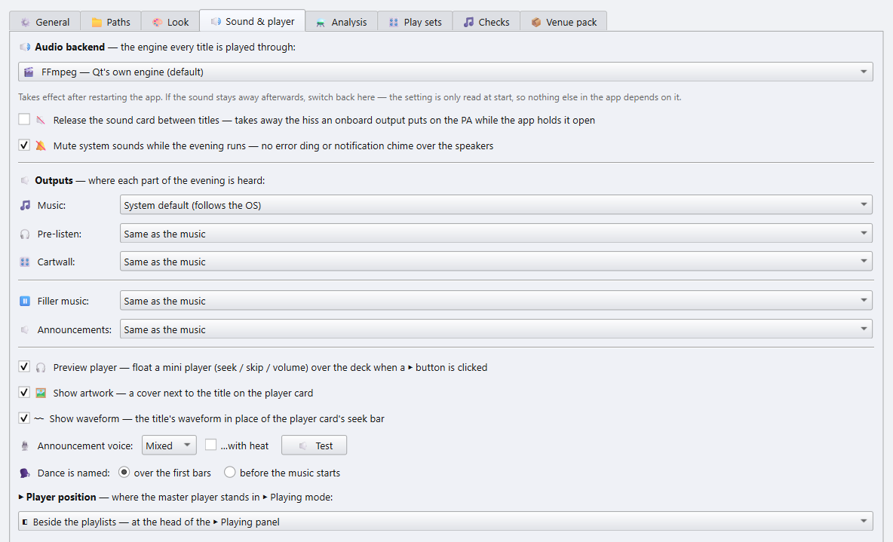

# 6 · Einstellungen

[Zurück zur Übersicht](README.md) · zurück: [Tags](05-tags.md)

Öffne **⚙ Einstellungen** unten im Wiedergabe-Bereich. Die Änderungen gelten,
sobald du auf **OK** klickst. Erscheinungsbild, Akzentfarbe, Sprache und das
Audio-Backend werden beim Start gelesen: für diese fragt die App nach einem
Neustart.

Die Reiter, der Reihe nach: **⚙ Allgemein**, **📁 Pfade**, **🎨 Aussehen**,
**🔊 Ton & Player**, **⚗ Analyse**, **🎛 Spiel-Sets** und **📦 Hallenpaket**.
Die volle App ergänzt **🎵 Prüfungen**, die Schwellenwerte ihrer
Musikprüfung; der Player blendet ihn aus.

## Allgemein

Der Reiter **⚙ Allgemein**.

| Einstellung | Macht |
|---|---|
| **App-Modus** | Welche Seite der App zu sehen ist: *Beides*, *Nur Planer* oder *Nur Player*. Zurückschalten bringt alles wieder. Der Player-Build hat diese Zeile nicht. |
| **📱 Handy-Fernbedienung** | **📱 Server starten** startet die Handy-Fernbedienung und öffnet ihr Fenster über den Einstellungen. Solange sie läuft, heißt der Knopf **📱 Server stoppen**. Siehe [Kapitel 4](04-playing.md#-die-handy-fernbedienung). |
| **🎛 DJ-Controller** | **🎛 Einrichten…** öffnet das Fenster für einen USB-MIDI- oder HID-Controller. Siehe [Kapitel 4](04-playing.md#-ein-dj-controller). **⌨ Tasten…** legt dieselben Aktionen auf Tasten und enthält auch die Tasten der Cartwall, siehe [Kapitel 4](04-playing.md#-pult-tasten). |
| **🐞 Fehlerberichte senden** | Nur in Builds, die sie senden können. Stößt die App auf einen Fehler, schickt sie die technischen Details an den Entwickler: den Fehler, die letzten Protokollzeilen, das System und die App-Version. Nie deine Musik oder Playlists. Standardmäßig aus. |
| **🔔 Nach neuen Versionen suchen** | Einmal pro Start bei GitHub (api.github.com) fragen, ob ein neueres Release erschienen ist, und es einmal mit einem Link zur Downloadseite ankündigen. Die Anfrage enthält nichts über dich oder deine Musik; GitHub sieht die IP-Adresse, von der sie kommt. Es wird nichts heruntergeladen oder installiert. Standardmäßig aus; der erste Start fragt. Gilt ab dem nächsten Start. |

## Pfade

Der Reiter **📁 Pfade**.

Die Ordner beschreibt
[Kapitel 1](01-getting-started.md#der-app-deine-musik-zeigen). Zwischen ihnen
sitzt das **Playlist-Dateiformat**: *UTF-8 (.m3u)*, *UTF-8 mit BOM (.m3u)*
oder *UTF-8 (.m3u8)*, siehe
[Kapitel 3](03-playlists.md#das-playlist-dateiformat).

## Aussehen

Der Reiter **🎨 Aussehen**.

- **🎨 Erscheinungsbild**: eine Liste aller Looks, jeder mit einem Bild des
  Hauptfensters darin neben der Liste.
  - **Standard**: das klassische *Hell*, die Vorgabe, und *Dunkel* für eine
    dunkle Halle. Sie behalten die Emoji auf den Knöpfen und nehmen die
    Akzentfarbe von unten.
  - **Plattform-Looks**: Windows 11, macOS und Linux GNOME, jeweils hell und
    dunkel. Jeder Look lässt sich auf jedem System wählen.
  - **Pult-Looks**: *Konsole*, *Carbon*, *Neon* und *Studio*, dunkel wie ein
    Mischpult.
  - **Modern Looks**: *Graphit*, *Mitternacht*, *Aurora*, *Papier* und zwei
    Looks mit hohem Kontrast, vor allem auf Lesbarkeit hin ausgesucht.

  Ein Look gestaltet Knöpfe, Felder, Reiter und Menüs neu, bringt seine eigene
  Schrift und Akzentfarbe mit und tauscht die Emoji auf den Knöpfen gegen
  gezeichnete Symbole. Warnungen bleiben in jedem Theme rot.
  - **Eigene Looks**: Looks, die du selbst baust, gespeichert auf diesem
    Computer. **＋ Neuer Look…** kopiert den markierten Look (*Hell* und
    *Dunkel* beginnen bei *Papier* und *Graphit*) und öffnet den Editor: jede
    Farbe, die Ecken, der Stil von Knöpfen, Reitern und Fokus und die Schrift,
    mit einer Live-Vorschau daneben. Text, der sich zu schwach von seinem
    Hintergrund abhebt, wird als Warnung gelistet. **✎ Bearbeiten…** und
    **🗑 Löschen** ändern oder entfernen einen eigenen Look,
    **Exportieren…** speichert einen als `.json`-Datei und **Importieren…**
    fügt einen hinzu, den dir jemand gegeben hat. Diese Knöpfe speichern
    sofort. Änderst du den Look, in dem die App läuft, bietet sie beim
    Schließen der Einstellungen mit OK einen Neustart an.
- **🎚 Akzentfarbe**: das Blau der Knöpfe, Regler und des Player-Bereichs,
  für *Hell* und *Dunkel*. **↺ Standardblau** setzt es zurück. Farben, die
  etwas bedeuten, etwa rote Warnungen, behalten ihren Ton.
- **🌐 Sprache**: English, Deutsch, Español, Nederlands oder Русский.
  Titelnamen und alles, was aus deinen Dateien gelesen wird, bleiben, wie sie
  sind.
- **Deutsche Tanz- und Rundennamen auch in einer anderssprachigen
  Oberfläche**: *Langsamer Walzer*, *Vorrunde*, *Eintanzen* statt *Slow
  Waltz*, *Round 1*, *Practice*. Der Präsentationsbildschirm und die
  aufgenommenen Ansagen sind dann ebenfalls deutsch.

Erscheinungsbild, Akzentfarbe und Sprache wirken nach einem Neustart.

- **⛶ Uhr im Vollbild: nur die Uhrzeit (20:45:12), ohne Datum**: die Uhr in
  der Statusleiste, solange das Fenster im
  [Vollbild](01-getting-started.md#-vollbild) ist. Sie wechselt innerhalb
  einer Sekunde nach dem Speichern.
- **🖥 Präsentation**: die Farben der
  [Präsentation](04-playing.md#-präsentation). *Default* ist die schwarze
  Hallenanzeige. *Light* ist cremefarbenes Papier mit warmer brauner Schrift,
  für einen hellen Raum. Eine offene Präsentation wechselt, sobald du
  speicherst.

## Ton und Player

Der Reiter **🔊 Ton & Player**.

| Einstellung | Macht |
|---|---|
| **🔊 Audio-Backend** | Die Engine, über die jeder Titel spielt. Unter Windows: *FFmpeg* (die Vorgabe) oder *Windows Media Foundation*. Ändere es nur, wenn ein Titel nicht spielt oder ein Tempowechsel eine Lücke reißt. Wirkt nach einem Neustart. |
| **🔇 Die Soundkarte zwischen den Titeln freigeben** | Eine Onboard-Soundkarte legt ein Rauschen auf die Anlage, solange eine App sie offen hält. Diese Einstellung gibt das Gerät nach ein paar Sekunden Stille zurück. Der Preis ist ein leises Klicken, wenn der nächste Titel startet, schalte sie also nur ein, wenn du das Rauschen hörst. |
| **🔕 Systemklänge stummschalten, solange der Abend läuft** | Kein Fehler-Ding und kein Benachrichtigungston über die Lautsprecher. Die Systemklänge kommen zurück, wenn du die App schließt. |
| **🎧 Vorhör-Player** | Ein Mini-Player (Spulen, Springen, Lautstärke) schwebt über dem Deck, wenn du auf ein ▶ in einer Zeile klickst. |
| **🖼 Cover anzeigen** | Ein Cover neben dem Titel auf der Player-Karte. Es nimmt das eigene Bild der Playlist (`#EXTIMG`), eine Cover-Datei im Ordner oder das Bild in der MP3. |
| **〰 Wellenform anzeigen** | Die [Wellenform](04-playing.md#-die-wellenform) des Titels auf der Player-Karte anstelle des Suchbalkens. |
| **🎙 Ansagestimme** | Wer [🔈 Nächsten Tanz ansagen](04-playing.md#-nächsten-tanz-ansagen) spricht: *Weiblich*, *Männlich* oder *Gemischt* (die Vorgabe), was die beiden abwechselt. **…mit Gruppe** fügt die Nummer der Gruppe hinzu, standardmäßig aus. **🔈 Test** spricht ein Beispiel in der gezeigten Stimme, noch vor OK. |
| **🗣 Tanz wird angesagt** | Wo die Ansage sitzt, wenn ein Titel ohne Pause seinen Tanz beim Start nennt: **über den ersten Takten** (die Vorgabe; die Musik wird unter der Stimme leiser) oder **vor dem Musikstart** (die Musik folgt der Ansage). Das ▶ Abspielen-Panel nennt die Wahl kurz: *über der Musik* oder *vor der Musik*. |
| **▶ Player-Position** | Wo die Player-Karte steht: *neben den Playlists*, am Kopf des Wiedergabe-Bereichs, oder *über den Playlists*, als ein breiter Streifen über den Decks. |

### 🔈 Ausgänge

Wo welcher Teil des Abends zu hören ist. Jeder Ausgang, den das
Betriebssystem listet, lässt sich wählen, unter Windows, macOS und Linux.

| Ausgang | Spielt |
|---|---|
| **🎵 Musik** | Die Titel. *Systemstandard (folgt dem System)* geht dorthin, wohin Windows seinen Ton schickt. |
| **🎧 Vorhören** | ▶ in der 📚 Bibliothek und im Bereich 🏆 Turniere, mit einem eigenen Mini-Player, während die Musik weiterläuft. Siehe [Kapitel 4](04-playing.md#-vorhören-über-kopfhörer). |
| **🎛 Cartwall** | Die Pads. |
| **⏸ Pausenmusik** | Die Musik in der Pause. |
| **🔈 Ansagen** | Die gesprochenen Ansagen. |

- Jeder Ausgang außer der Musik beginnt auf **Wie die Musik**.
  *Systemstandard* hält einen davon auf dem Standard fest, während die Musik
  woanders spielt.
- Auf einer Soundkarte mit mehreren Ausgängen kann jedes Paar, das das System
  als eigenes Gerät zeigt („Out 3/4“ neben „Out 1/2“), eine eigene Quelle
  bekommen. Die Kanäle 3/4 *eines* Mehrkanalgeräts lassen sich nicht einzeln
  wählen.
- Eine Karte, die nicht angeschlossen ist, spielt mit einer Meldung auf dem
  Systemstandard, und der Ton geht zurück auf die Karte, sobald sie wieder da
  ist. Das Vorhören ist die Ausnahme, wenn dieser Standard der Ausgang der
  Musik ist: es wird abgelehnt, damit nichts, was für die Kopfhörer gedacht
  ist, über die Anlage geht.
- Windows gibt einer neu angesteckten Karte manchmal eine neue Nummer, aus
  `2- ESI Audio Device` wird `3- ESI Audio Device`. Die App findet die Karte
  dann an ihrem Namen wieder, solange nur eine angeschlossene Karte so
  heißt.
- Solange die Karte für die 🎵 Musik angeschlossen ist, zeigt die
  Statusleiste ein kleines **🔊** mit ihrem Namen. Ein Klick darauf öffnet
  diesen Reiter.
- Die Wahl wirkt, sobald du OK klickst, ohne Neustart.

## Analyse

Der Reiter **⚗ Analyse** sammelt jede Analyse. Sie *liest* deine Dateien nur.
Alles wird zwischengespeichert, ein zweiter Lauf macht also nur, was neu ist.

Der Player braucht drei davon:

- **📊 Lautheit analysieren (R128)**: für *Lautstärke angleichen*.
- **🐂 PD-Highlights analysieren**: für den Paso-Doble-Stopp.
- **🔇 Stillen prüfen**: zum Überspringen von Stille am Anfang und Ende.

**📤 Manuelle PD-Marken exportieren / 📥 importieren** bringt die Höhepunkte,
die du von Hand markiert hast, auf einen anderen PC. Aus der vollen App
gestartet, listet der Reiter weitere Analysen; der Player-Build zeigt nur
diese.

Die von Hand gesetzten PD-Marken, die in der App geänderten Tags und das
Protokoll der [gespielten Titel](04-playing.md#-gespielte-titel) sind die
einzigen Daten, die keine Analyse wiederfindet, deshalb sichert die App sie
selbst: beim ersten Start jedes Tages schreibt sie eine kleine Datei in den
Ordner `backups` neben ihrer Datenbank, bringt sie beim Beenden auf den
neuesten Stand und hebt die letzten sieben auf.
**Sicherungsordner** legt sie stattdessen woanders ab, etwa in einem
Dropbox-Ordner, damit sie nicht nur auf diesem PC liegen; jeder PC schreibt in
einen eigenen Unterordner mit seinem Namen.
**♻ Sicherung der eigenen Daten zurückholen…** spielt eine davon wieder ein;
sie wirkt nach einem Neustart.

**🧱 ALLE Caches aufbauen…** lässt jede Analyse der Reihe nach laufen, für
eine Bibliothek deiner Wahl. Sie lässt sich abbrechen.

**🧹 Datenbank aufräumen…** entfernt zwischengespeicherte Zeilen für Dateien,
die es nicht mehr gibt, und verdichtet die Datenbank. Sie läuft nicht, wenn
das Musiklaufwerk nicht eingebunden aussieht, damit die Analyse nicht aus
Versehen gelöscht wird.

## Spiel-Sets

Der Reiter **🎛 Spiel-Sets** legt fest, was die Knöpfe **🏆 Turnier-Set** und
**🎉 Party-Set** im Wiedergabe-Bereich anwenden (siehe
[Kapitel 4](04-playing.md#abspiel-sets)).

Für jedes Set:

- **Spieldauer**: wähl eine, tipp `m:ss` oder Sekunden, oder wähl
  *komplett*.
- **Ausblenden**, in Schritten von einer halben Sekunde, und **innerhalb der
  Spieldauer**: angehakt endet das Ausblenden mit der Spieldauer, nicht
  angehakt kommt es danach. Die Spieldauern je Tanz im 🏆 Set folgen dem
  ebenfalls. Ab Werk blendet das 🏆 Set nach der Spieldauer aus, das 🎉 Set
  darin.
- **🔀 Überblenden**: ein Schalter und 0,5 bis 10 s in Schritten von einer
  halben Sekunde, mit demselben Kurvenknopf (gleiche Leistung, geradlinig oder
  S-Kurve) und Bild wie im Wiedergabe-Bereich. Ab Werk in beiden Sets aus,
  eingeschaltet mit 4 s und gleicher Leistung.
- **⏭ Automatisch zum nächsten Titel**,
  **⏸ Keine Pause zwischen den Titeln**, **🔈 Nächsten Tanz ansagen**,
  **🔊 Lautstärke angleichen**, **▶️ Doppelklick startet den Titel**,
  **❓ Fragen, bevor ein Doppelklick den Titel anhält** und
  **🎚 TSO: auf den Takt der Gruppe ziehen**.

Das Turnier-Set hat außerdem **⏱ Pro Tanz**: eine Dauer je Tanz. Lass einen Tanz
auf *— Länge des Sets*, wähl *komplett* oder eine Stufe, oder tipp `m:ss`. Ein
Tanz mit eigener Dauer wird dort geschnitten, solange eine Liste auf dem 🏆 Set
steht. Ab Werk: 1:30 für Langsamen Walzer, Wiener Walzer, Quickstep und Jive,
1:37 für Tango, Slowfox, Samba, Cha-Cha-Cha und Rumba, der Paso Doble *komplett*.

Beide Sets haben auch den 🐂 Paso Doble: **Stopp nach Highlight** (und nach
welchem) und **Start nach**. Von Haus aus ist im Turnier-Set der Stopp aus,
weil die Erkennung nicht zuverlässig genug ist, um einen Paso Doble im
Turnier zu schneiden, und Start nach steht auf 0 s. Das Party-Set stoppt
nach dem 2. Highlight und wartet 3 s, damit die Paare ihre Ausgangsposition
einnehmen können.

**🎚 TSO-Zieltakt** legt pro Tanz fest, auf welches Tempo der Knopf TSO eine
Gruppe zieht:

- **Mittelwert der Runde**: bringt die ganze Runde auf ein Tempo, dort, wo
  die meisten ihrer Titel schon liegen. Kein Titel bewegt sich um mehr als
  einen Takt pro Minute.
- **Unten / Mitte / Oben**: ein festes Tempo innerhalb des TSO-Bereichs. Das
  lohnt sich bei den langsamen Tänzen, wo ein Takt pro Minute eine viel
  größere Tempoänderung ist.

## Hallenpaket

Das **📦 Hallenpaket** bringt das ganze Pult in einer Datei auf einen anderen
PC: die Einstellungen, jedes Deck und jede Wunschliste und die 🎛 Cartwall mit
ihren Pads und Tasten. Wenn du willst, kommt auch die Musik mit, die sie
benutzen.

- **📦 Hallenpaket exportieren…** schreibt die Datei. Ein Fortschrittsfenster
  zeigt, wie weit es ist, und kann abbrechen. Vorgeschlagen wird
  `venue-<Datum>.dpvenue`, oder `venue-<Datum>-with-music.dpvenue`, wenn die
  Musik mit hineinkommt.
- **📥 Hallenpaket importieren…** lädt es auf dem anderen PC. Es übernimmt
  Einstellungen, Decks und Cartwall beim nächsten Start; was es ersetzt, wird
  in einem Ordner `before-venue-import` daneben aufgehoben. Musik im Paket
  wird in einen Ordner deiner Wahl ausgepackt, und jedes Deck und jedes Pad
  wird darauf umgehängt.

Ordner-Einstellungen wie die Bibliothek, der Playlist- und der
Speichern-unter-Ordner, der Präsentationsbildschirm und das Audio-Backend
bleiben bei jedem PC.

Weiter: [Tastatur und Maus](07-shortcuts.md)
